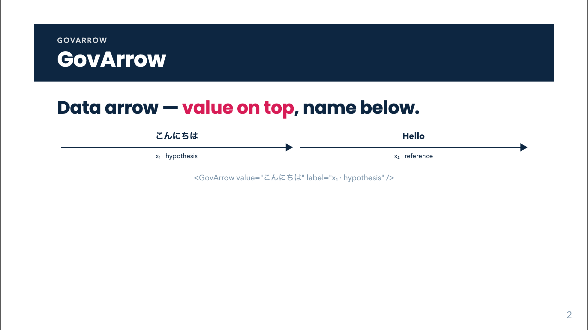



# GovArrow



## Overview

`GovArrow` is the **data arrow**: data travelling from one stage to the next. The example value rides **on top of the line**, and its name or explanation sits **below in ink**. The arrow carries no box and no grey text. The deck's rule is that I/O is never boxed; only a processing stage may carry a shape.

Use it for any input to stage or stage to output flow, usually inside a [GovPipe](gov-pipe.html) or a hand-built `.gov-flow` row. Do not use it for a logical "therefore" (that is [GovTriangle](gov-triangle.html) / [GovChain](gov-chain.html)).

## Quick start

<!-- demo: gov-arrow-quick-start -->
```html
<GovArrow value="こんにちは" label="x₁ · hypothesis" />
```

## Props

| Prop | Type | Default | Description |
|---|---|---|---|
| `value` | `string` | none | Example value shown above the line (bold, 0.9rem, never wraps). |
| `label` | `string` | none | Name or explanation shown below the line (0.68rem, ink colour, never wraps). |

**Both props are rendered as plain text** (`{{ }}` interpolation): HTML is escaped and `$…$` is **not** typeset. For markup or LaTeX use the slots.

## Slots

| Slot | Description |
|---|---|
| `value` | Replaces the `value` prop. Any inline markup. |
| `label` | Replaces the `label` prop. Any inline markup. |

## Feature guides

### Rich value or label

<!-- demo: gov-arrow-rich-value-or-label -->
```html
<GovArrow>
  <template #value><b>ŷ</b> = Hello</template>
  <template #label>output · <i>after filter</i></template>
</GovArrow>
```

### Several arrows side by side

Arrows are `flex: 1 1 auto` with a minimum width of 5.5rem, so inside a flex row they share the space. Put them in a `gov-flow` row:

<!-- demo: gov-arrow-several-arrows-side-by-side -->
```html
<div class="gov-flow">
  <GovArrow value="Hello" label="x₁" />
  <GovBox label="Model" />
  <GovArrow value="Bonjour" label="ŷ" />
</div>
```

For N inputs and M outputs around one stage use [GovPipe](gov-pipe.html), which builds the arrows from arrays.

### Colour variants

There is no `color` prop, but the stylesheet defines `.gov-io--green` and `.gov-io--red` (line and arrowhead turn sage / crimson). Attributes fall through to the root, so add the class directly:

<!-- demo: gov-arrow-colour-variants -->
```html
<GovArrow class="gov-io--green" value="410 → 40 ms" label="latency" />
<GovArrow class="gov-io--red" value="O(n²)" label="cost" />
```

## Animation, click behaviour and print

Every `GovArrow` is wrapped in `v-click` and slides in from the left (2rem, 0.1s ease-out) on the **next click**. Each arrow consumes its own click, so a `GovPipe` with three arrows needs three clicks. Static exports and print (`@media print` disables the transition and translate) show the final state with all arrows visible.

You cannot turn the click off with a prop. If an arrow must be visible immediately, build the same markup by hand (`<span class="gov-io"> … </span>`) without `v-click`.

## Styling hooks

| Class | Role |
|---|---|
| `.gov-io` | Root: flex column, `min-width: 5.5rem`, `padding: 0 0.4rem`. |
| `.gov-io-value` | The value above the line: bold, 0.9rem, `white-space: nowrap`. |
| `.gov-io-line` | The 2px navy line; `::after` draws the arrowhead. |
| `.gov-io-label` | The name below, 0.68rem, navy, nowrap. |
| `.gov-io--green`, `.gov-io--red` | Colour variants for line and head. |
| `.gov-io.slidev-vclick-hidden` | Hidden state (translated 2rem left). |
| `--navy`, `--sage`, `--crimson` | Palette variables used by the above. |

Inside `.dd-body` (GovDerivation annotation panels) the value and label are enlarged to 0.92rem.

## Common mistakes

- **HTML or LaTeX in `value` / `label` props.** They are escaped text. Use the `#value` / `#label` slots.
- **Expecting an arrow to be visible without a click.** It is a click-revealed element; in a pipe the clicks add up.
- **Boxing the value.** The visual language reserves boxes for stages. Keep values bare.
- **Long values.** Value and label are `nowrap`; long strings widen the arrow or overflow. Shorten them or enlarge the container.

