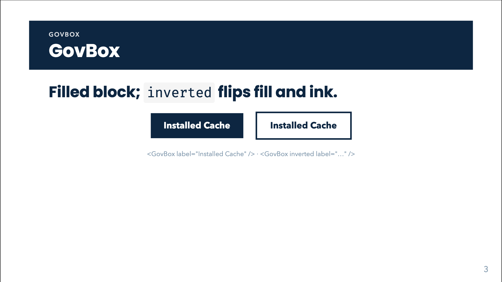

# GovBox



## Overview

`GovBox` is the deck's **filled label block**: a navy rectangle with bold white text. It is the one "thing" shape of the diagram vocabulary. Use it for a named object, a claim or a step that other primitives point at: a premise in a [GovChain](gov-chain.html), the stage of a [GovPipe](gov-pipe.html), a node on its own.

Two looks carry meaning:

- **Filled** (default): navy fill, white text. The "emphasised" or "established" element.
- **Inverted**: white fill, navy text and a navy outline. The lighter, "given" or "still open" element. In a chain it is the usual way to separate premises from the conclusion.

Use it when the content is short (a phrase or one formula). For a long sentence use [GovStress](gov-stress.html) (headless), and for a data value travelling between stages use [GovArrow](gov-arrow.html), because data values are never boxed.

## Quick start

<!-- demo: gov-box-quick-start -->
```html
<GovBox label="Installed Cache" />
<GovBox inverted label="Installed Cache" />
```

## Props

| Prop | Type | Default | Description |
|---|---|---|---|
| `label` | `string` | none | Text of the box. Rendered as HTML (`<b>`, `<br>`, `<span class="…">` work) and `$…$` / `$$…$$` are typeset with KaTeX. Ignored when the default slot is used. |
| `inverted` | `boolean` | `false` | White fill, navy text, 3px navy outline instead of the navy fill. |
| `size` | `string \| number` | inherited | Text size. A number is an em multiplier of the inherited size (`1.2` is 120%); a string is any CSS length (`'0.8rem'`). Empty string or omitted leaves the size inherited. |

## Slots

| Slot | Description |
|---|---|
| default | Replaces `label`. Slot content is **not** passed through the LaTeX typesetter, so write plain HTML or Slidev inline markup here. |

## Feature guides

### Inverted variant

<!-- demo: gov-box-inverted-variant -->
```html
<GovBox inverted label="Given" />
```

`inverted` is a boolean attribute; write it bare, or `:inverted="false"` to switch it off programmatically.

### LaTeX labels

`label` goes through `typeset()` in `components/math.ts`: text between `$…$` is inline math, between `$$…$$` is display math (rendered inline inside the box, with no block margin). `\$` gives a literal dollar sign. Anything outside the delimiters is left as raw HTML.

In a plain attribute write single backslashes. Inside a bound (`:label="…"`) JavaScript string, double them.

<!-- demo: gov-box-latex-labels -->
```html
<GovBox label="$$\mathbf{A} \in \mathbb{C}^{n \times n}$$" />
<GovBox :label="'Operator $\\mathbf{A}_r$ <br> reduced'" />
```

### Text size

<!-- demo: gov-box-text-size -->
```html
<GovBox label="Small print" size="0.8rem" />
<GovBox label="Big claim" :size="1.6" />
```

Note that a bare `size="1.6"` is the **string** `"1.6"`, which is not a valid CSS length. Bind numbers with `:size="1.6"`.

### Custom content through the slot

<!-- demo: gov-box-custom-content-through-the-slot -->
```html
<GovBox>
  Latency <span style="color:#f3a9c3">410 ms</span>
</GovBox>
```

### Inside other components

`GovChain` renders each `{ box: '…', inverted, size }` item as a `GovBox` (with the extra class `gov-chain-top` / `-bottom` / `-left` / `-right`); `GovPipe`'s `stage-box` prop renders one as the stage.

## Animation, click behaviour and print

`GovBox` has no animation of its own and shows immediately. To reveal it on click, put Slidev's directive on it: `<GovBox v-click label="…" />` or `v-click.fade-in="3"`. Printing/PDF export renders it as-is.

## Styling hooks

| Hook | Effect |
|---|---|
| `.gov-box` | Navy fill, white text, `border: 3px solid transparent`, padding `0.7rem 1.6rem`, bold, centred. |
| `.gov-box--inverted` | White fill, navy text, 3px navy outline. |
| `.gov-box .katex`, `.gov-box .katex-display` | Display math is set to `display: contents`, margin 0, so formulas do not balloon the box. |
| `--navy` | The fill / text / outline colour (`:root`, default `#0d2641`). Override it to recolour every box in the deck. |

Per-box overrides work via `class` / `style` on the tag (attributes fall through to the root element): `<GovBox style="width:12rem" label="…" />`. The box is a block-level `div`, so it stretches to its container; wrap it in a flex container or give it a width to shrink it.

## Common mistakes

- **`size="1.2"` with no binding.** It becomes the CSS string `1.2`, which browsers ignore. Use `:size="1.2"` for an em multiplier or `size="1.2em"`.
- **LaTeX in the slot.** Only the `label` prop is typeset. `<GovBox>$x$</GovBox>` goes through Slidev's own markdown pipeline instead, which may or may not typeset depending on the surrounding block. Prefer `label`.
- **Single backslashes in bound props.** In `:label="'$\mathbf{A}$'"` the JS string eats `\m`. Double them (`\\mathbf`).
- **Boxing data values.** A value travelling between stages belongs on a [GovArrow](gov-arrow.html), not in a box.
