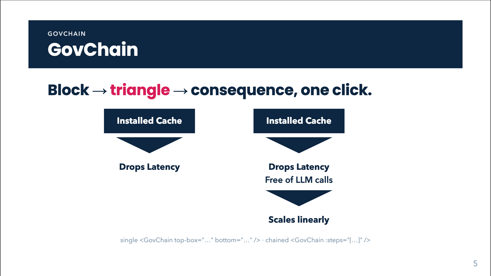

# GovChain



## Overview

`GovChain` is the deck's **argument component**: premises on top, a wide "therefore" triangle in the middle, conclusions below. It reads as "these, therefore that". It is built on [GovBox](gov-box.html) and [GovTriangle](gov-triangle.html) and handles their layout, equal-width fan-out and click reveal for you.

Either side is a **list**, in the manner of [GovPipe](gov-pipe.html):

- N premises converge on the triangle ("these, therefore ...").
- M conclusions fan out below it ("... therefore these").
- Either side may be empty, leaving a lone triangle (annotate it with `label`).
- `lefts` / `rights` add **side branches** ("therefore, but also: infeasible").
- `steps` chains several implications back to back (A therefore B therefore C).

Use it for derivations of the "because / therefore" kind, a claim and its consequence, or a signpost slide ("Why linear? -> closed form"). Do not use it for data flowing through a processing stage (use [GovPipe](gov-pipe.html)) or for a sequence of unrelated stages.

## Quick start

<!-- demo: gov-chain-quick-start -->
```html
<GovChain top-box="Installed Cache" bottom="Drops Latency" />
```

A chain with two implications; the first click reveals the first triangle and conclusion, the second click the next:

<!-- demo: gov-chain-quick-start-2 -->
```html
<GovChain
  :steps="[
    { tops: [{ box: 'Installed Cache', inverted: true }], bottoms: ['Drops Latency'] },
    { bottoms: [{ box: 'Scales linearly' }] },
  ]" />
```

## Props

Every prop can be used on the component (single-step mode) and, except where noted, inside each object of `steps`.

| Prop | Type | Default | Description |
|---|---|---|---|
| `tops` | `Item[]` | none | Premises above the triangle. See *Items* below. |
| `top` | `string` | none | Single-item sugar: one bold text premise (HTML / LaTeX). Empty string means "no top". |
| `topBox` (`top-box`) | `string` | none | Single-item sugar: one **filled** GovBox premise. |
| `bottoms` | `Item[]` | none | Conclusions below the triangle. |
| `bottom` | `string` | none | Single-item sugar: one bold text conclusion. |
| `bottomBox` (`bottom-box`) | `string` | none | Single-item sugar: one filled GovBox conclusion. |
| `lefts` | `Item[]` | none | Side branch on the left. Has no sugar form. |
| `rights` | `Item[]` | none | Side branch on the right. Has no sugar form. |
| `label` | `string` | none | Condition written on a plate centred on the triangle (HTML / LaTeX). Per step as `steps[k].label`. |
| `color` | `'navy' \| 'green' \| 'red'` | `'navy'` | Colour of the **triangle(s)** only; boxes are always navy. In steps mode it applies to every step's triangle (there is no per-step colour). |
| `dir` | `'down' \| 'up' \| 'left' \| 'right'` | inferred, else `'down'` | Pointing direction; `down`/`up` build a vertical chain, `left`/`right` a horizontal one. Also accepted per step; the per-step value wins over the component's. |
| `steps` | `Step[]` | none | A list of steps (`tops`, `topBox`, `top`, `bottoms`, `bottomBox`, `bottom`, `lefts`, `rights`, `label`, `dir`). When present, the top-level `tops` / `bottoms` / `label` etc. are ignored (only `color` and `dir` are inherited). |
| `at` | `number` | none | Absolute click at which the first tail appears; step `k` appears at `at + k`. See *Click behaviour*. |

**Precedence per side:** the list (`tops`) wins over the box sugar (`topBox`), which wins over the plain sugar (`top`); likewise for bottoms.

### Items

An item is a **string** or an **object**:

| Form | Renders |
|---|---|
| `'Drops Latency'` | Bold text (`.gov-chain-top` etc.), HTML and `$…$` / `$$…$$` LaTeX allowed. |
| `{ html: '…', size }` | Same as the string form, with an optional `size`. |
| `{ box: '…', inverted?, size? }` | A [GovBox](gov-box.html). Filled navy by default; `inverted: true` gives a white box with a navy outline. `size`: number = em multiplier, string = CSS length. |

If an object has both `box` and `html`, `box` wins.

## Slots

Slots exist in **single-step mode only** (they are ignored when `steps` is used).

| Slot | Description |
|---|---|
| `top` | Replaces the premises (in a horizontal chain, replaces everything on the premise side). |
| `triangle` | Replaces the triangle, e.g. with a hand-made `<GovTriangle color="red" label="…" />`. In a horizontal chain it is placed on the correct side of the conclusions. |
| `bottom` | Replaces the conclusions. |

Slot content is not run through the LaTeX typesetter (write HTML, or put the text in a `GovBox label`).

## Feature guides

### Boxes versus text

Plain strings render as bold text; box items render as GovBox blocks. Mixed lists are fine.

<!-- demo: gov-chain-boxes-versus-text -->
```html
<GovChain top-box="Installed Cache" bottom="Drops Latency" />
<GovChain top-box="Installed Cache" bottom-box="Drops Latency" />
<GovChain top="<b>Installed Cache</b>" bottom="Drops <u>Latency</u>" color="green" />
```

### Inverted boxes and sizes

Use `inverted` for the "given" side and a filled box for the conclusion (the pattern used throughout the ACL deck):

<!-- demo: gov-chain-inverted-boxes-and-sizes -->
```html
<GovChain top-box="Cache hit" :bottoms="[{ box: 'Drops Latency', inverted: true }]" />
<GovChain :tops="[{ box: 'Cache hit', size: '0.8rem' }]" :bottoms="[{ box: 'Drops Latency', size: 1.2 }]" />
```

`{ box: 'YES!', inverted: true, size: 2.4 }` makes a 240% box; combine with `<br>` and spans for a small second line.

### LaTeX

Everything is typeset: `top`, `bottom`, `label`, `box` and `html` strings. Single backslashes in plain attributes, **doubled backslashes inside bound `:tops="[...]"` / `:steps="[...]"`** (they are JS strings in a Vue expression).

<!-- demo: gov-chain-latex -->
```html
<GovChain top-box="$$\mathbf{A} \in \mathbb{C}^{n \times n}$$" bottom="Drops Latency" />
<GovChain
  :tops="[{ box: '$\\mathbf{X}^\\prime \\approx \\mathbf{A} \\mathbf{X}$', inverted: true }]"
  :bottoms="['Closed form: $\\mathbf{x}(t) = \\sum_k b_k \\psi_k e^{\\alpha_k t}$']" />
```

Display math is flattened inline inside chain items (`display: contents`), so `$$…$$` does not add block margins. Quote attributes inside a bound string as `&quot;` when the surrounding attribute uses double quotes (as in `<span class=&quot;x&quot;>`).

### Labelled triangle

`label` puts the condition on the triangle:

<!-- demo: gov-chain-labelled-triangle -->
```html
<GovChain top-box="Cache hit" bottom="Drops Latency" label="When $n$ is large" color="green" />
```

### Multiple premises and conclusions (fan-in / fan-out)

In a vertical chain, items of one side sit in a row of equal-width columns so the triangle points at the centre between them.

<!-- demo: gov-chain-multiple-premises-and-conclusions-fan-in -->
```html
<GovChain
  :tops="['$$\\mathbf{A} \\in \\mathbb{C}^{n \\times n}$$', { box: 'n is large' }]"
  :bottoms="['A is infeasible', { box: 'O(n³) flops' }]"
  label="When $n$ is large" />
```

### Empty sides (lone triangle)

<!-- demo: gov-chain-empty-sides-lone-triangle -->
```html
<GovChain label="Why Linear?" bottom="Memory Efficiency" />   <!-- 0 premises -> 1 conclusion -->
<GovChain top-box="Cache hit" />                              <!-- 1 premise -> triangle alone -->
```

### Direction

| `dir` | Layout |
|---|---|
| `down` (default) | Vertical: tops, ▼, bottoms. Items of a side form a row. |
| `up` | Same vertical layout and order, the triangle is flipped to ▲. Only the mark is rotated. |
| `right` | Horizontal: a column of tops (and lefts), ▶, a column of bottoms (and rights). |
| `left` | Mirrored: bottoms (and lefts), ◀, then tops (and rights) on the right. |

<!-- demo: gov-chain-direction -->
```html
<GovChain dir="right" top-box="Cache hit" :bottoms="['Drops Latency', 'No LLM calls']" />
```

In a horizontal chain the items of a side stack in a **column** (perpendicular to the flow). With an explicit horizontal `dir`, `lefts` and `rights` are placed as their own columns: for `right`, `lefts` join the premise side and `rights` the conclusion side; for `left` the roles are swapped. The explicit `dir` also keeps the full-size triangle.

### Side branches (`lefts`, `rights`)

With `bottoms` present, side branches flank the vertical triangle in one row:

<!-- demo: gov-chain-side-branches-lefts-rights -->
```html
<GovChain top-box="A is n×n" :rights="['Infeasible']" :bottoms="['O(n³)']" />
```

With **no bottoms** and only one of `lefts` / `rights`, the step turns horizontal automatically and the triangle becomes a compact ▶ / ◀ (class `gov-therefore--sm`; not compact when a `label` is set or `dir` is explicit):

<!-- demo: gov-chain-side-branches-lefts-rights-2 -->
```html
<GovChain :rights="[{ box: 'Infeasible' }]" />     <!-- ▶ Infeasible -->
<GovChain :lefts="[{ box: 'Infeasible' }]" />      <!-- Infeasible ◀ -->
```

If you give both `lefts` and `rights` and no bottoms, the chain stays vertical and shows the cross row.

### Steps (chaining)

`steps` renders its steps back to back in one vertical column. The conclusion of step *k* is followed directly by the triangle of step *k+1*, so omit `tops` in later steps:

<!-- demo: gov-chain-steps-chaining -->
```html
<GovChain
  :steps="[
    { tops: ['Installed Cache'], bottoms: ['Drops Latency'], label: 'When $n$ is large' },
    { top: '<b>Free of LLM calls</b>', bottom: 'Scales linearly' },
  ]" />
```

A step can switch direction, e.g. end with a side branch:

<!-- demo: gov-chain-steps-chaining-2 -->
```html
<GovChain
  :steps="[
    { tops: ['If $n$ = 1 billion'], bottoms: ['4,000 PB'] },
    { rights: ['Infeasible'] },
  ]" />
```

Real example from the ACL talk (premise inverted, two conclusions, then a conclusion step):

<!-- demo: gov-chain-steps-chaining-3 -->
```html
<GovChain
  :steps="[
    {
      tops: [{ box: 'Obtain Linear Dynamics $\\mathbf{A}$', inverted: true }],
      bottoms: [{ box: 'Obtain Eigenvectors $\\mathbf{\\Psi}$', inverted: true },
                { box: 'Obtain Eigenvalues $\\mathbf{\\Lambda}$', inverted: true }],
    },
    { bottoms: [{ box: 'Continuous Time Extrapolation <br> $\\boxed{\\mathbf{x}(t) = \\sum b_k \\psi_k e^{\\alpha_k t}}$', inverted: false }] },
  ]" />
```

Steps notes: `color` and `dir` on the component apply to every step; `dir` per step overrides; there is no per-step `color`.

## Animation, click behaviour and print

- **Premises are always visible.** Only the **tail** (triangle + side branches + conclusions) is click-gated, and the whole tail fades in (0.3s) while the triangle slides into place (2.5rem drop for vertical, 1.5rem horizontal). Premise-triangle-conclusion arrives as one motion.
- **One click per tail.** A single-mode chain takes one click; a `steps` chain takes one click per step, in order. The tails are relative `v-click`s, so they follow the slide's running click count.
- **Tops of later steps are not gated.** If step 2 has `tops`, they are visible from the start. Put new material in `bottoms`.
- **Pinning to an absolute click.** If the whole chain is revealed with `<GovChain v-click="4" … />`, the inner tails would otherwise resolve against the running offset and appear *before* the container. So the component detects a numeric `v-click` on itself and pins tail *k* to `4 + k`. For wrappers (`<div v-click="4"><GovChain … /></div>`) pass the anchor yourself with `at`: `<GovChain :at="4" … />`. Only a numeric value is detected; a bare `v-click` is relative.
- **Print / PDF export** shows the final state: all tails are visible. `@media print` is not needed for the chain itself.

<!-- demo: gov-chain-animation-click-behaviour-and-print -->
```html
<div v-click="4">
  <GovChain :at="4" :steps="[{ tops: ['If n = 1 billion'], bottoms: ['1 quintillion elements'] }, { bottoms: ['4 exabytes'] }]" />
</div>
```

## Styling hooks

| Class | Role |
|---|---|
| `.gov-chain` | Root (flex column, centred). Modifiers `.gov-chain--v` (vertical), `.gov-chain--h` (horizontal), `.gov-chain--left` (leftward horizontal). |
| `.gov-chain-item` | One side group (premises / conclusions / a side branch). Vertical: inline grid, one row of equal columns, `gap: 1.5rem`. Horizontal: a column, `gap: 0.45rem`. |
| `.gov-chain-top`, `-bottom`, `-left`, `-right` | Each item (also added to the GovBox of box items). Text items are bold. `.gov-chain-bottom` has `margin-top: 0.45rem` (0 when horizontal). |
| `.gov-chain-tail` | The click-revealed part (`display: flex`, 0.3s opacity transition). |
| `.gov-chain-cross`, `.gov-chain-side` | Row holding `lefts` / ▼ / `rights`, and the side groups in it. |
| `.gov-therefore--sm` | Compact triangle for an inferred side branch. |
| `.gov-box`, `.gov-box--inverted`, `.gov-therefore*` | See [GovBox](gov-box.html) and [GovTriangle](gov-triangle.html). |
| `--navy`, `--sage`, `--crimson` | Palette variables. |

Tune spacing from your deck stylesheet, for example `.gov-chain--v .gov-chain-item { gap: 2.5rem; }`. For one chain, wrap it in a `<div class="my-chain">` and scope the override to it. The component's own root accepts `class` and `style` (e.g. `<GovChain class="my-chain" … />`).

## Common mistakes

- **Single backslashes in bound props.** `:tops="['$\mathbf{A}$']"` loses the backslash. Use `\\mathbf` inside `:tops` / `:bottoms` / `:steps`; a plain `top-box="$\mathbf{A}$"` attribute takes single backslashes.
- **Top-level `tops` together with `steps`.** They are ignored. Put premises inside the first step.
- **Repeating `tops` in later steps.** The previous step's conclusion already sits above the new triangle. Later-step tops show immediately.
- **Forgetting the number of clicks.** N steps means N clicks; budget them with the rest of the slide.
- **`v-click="n"` on a wrapper without `at`.** The tails appear before the wrapper does. Pass `:at="n"`.
- **Expecting `color` to colour boxes.** It colours only the triangle(s).
- **Expecting `dir="up"` to put conclusions above.** It only flips the triangle; swap `tops` and `bottoms` yourself if you need the opposite reading order.
- **`size="1.2"` as a string** inside an item. Use the number `1.2` (an em multiplier) or `'1.2em'`.
- **Slots with `steps`.** `top` / `triangle` / `bottom` slots work only in single-step mode.
