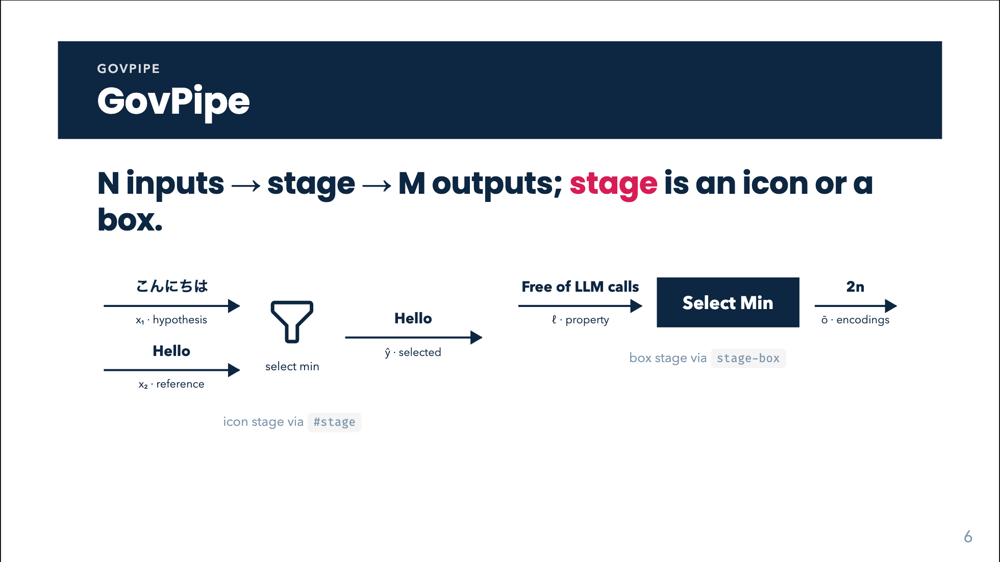

# GovPipe



## Overview

`GovPipe` draws a **data flow**: N inputs arrive through arrows, pass through a single processing **stage**, and M outputs leave through arrows. Values ride on top of their arrows and names sit below in ink (see [GovArrow](gov-arrow.html)); only the stage may carry a shape (an icon with a caption, or a filled [GovBox](gov-box.html)).

Use it for "what goes into this component and what comes out". Do not use it for logical implication (that is [GovChain](gov-chain.html)): the [GovTriangle](gov-triangle.html) never belongs inside a pipe.

## Quick start

<!-- demo: gov-pipe-quick-start -->
```html
<GovPipe
  :inputs="[
    { value: 'こんにちは', label: 'x₁ · hypothesis' },
    { value: 'Hello',     label: 'x₂ · reference' },
  ]"
  :outputs="[{ value: 'Hello', label: 'ŷ · output' }]"
  stage-box="Select min" />
```

## Props

| Prop | Type | Default | Description |
|---|---|---|---|
| `inputs` | `{ value?: string, label?: string }[]` | `[]` | Arrows entering the stage, stacked vertically. |
| `outputs` | `{ value?: string, label?: string }[]` | `[]` | Arrows leaving the stage, stacked vertically. |
| `stageBox` (`stage-box`) | `string` | none | Renders a filled `GovBox` as the stage (label HTML / LaTeX). Used only when the `#stage` slot is not provided. |

Each `value` / `label` goes to [GovArrow](gov-arrow.html), which renders it as **plain text** (HTML escaped, no LaTeX). For markup use the `#inputs` / `#outputs` slots.

## Slots

| Slot | Description |
|---|---|
| `stage` | The stage: an icon with a caption, a box, a chip, any markup. Overrides `stage-box`. |
| `inputs` | Replaces the whole input column (put your own `GovArrow`s or markup). |
| `outputs` | Replaces the whole output column. |

## Feature guides

### Icon stage

<!-- demo: gov-pipe-icon-stage -->
```html
<GovPipe
  :inputs="[{ value: 'こんにちは', label: 'x₁ · hypothesis' }, { value: 'Hello', label: 'x₂ · reference' }]"
  :outputs="[{ value: 'Hello', label: 'ŷ · output' }]">
  <template #stage>
    <span class="gov-node gov-node--icon">
      <carbon:filter class="gov-node-icon" />
      <span class="gov-node-sub">select min</span>
    </span>
  </template>
</GovPipe>
```

The `carbon:filter` icon comes from Slidev's icon integration (any `collection:name` icon works).

### Box stage

<!-- demo: gov-pipe-box-stage -->
```html
<GovPipe :inputs="[{ value: '0.82', label: 'score' }]" :outputs="[{ value: 'accept', label: 'verdict' }]" stage-box="Threshold" />
```

Use a custom `#stage` slot with `<GovBox inverted label="…" />` for a white box.

### Rich arrows

<!-- demo: gov-pipe-rich-arrows -->
```html
<GovPipe stage-box="Model">
  <template #inputs>
    <GovArrow><template #value><b>x</b></template><template #label>input</template></GovArrow>
  </template>
  <template #outputs>
    <GovArrow class="gov-io--green" value="ŷ" label="output" />
  </template>
</GovPipe>
```

### Only inputs or only outputs

Omit the other array; its column renders empty (the stage then sits at one end of the row).

## Animation, click behaviour and print

`GovPipe` itself is not animated, but every [GovArrow](gov-arrow.html) inside carries its own `v-click` and slides in from the left. **Each arrow costs one click**, in DOM order: all inputs, then all outputs. A pipe with 2 inputs and 1 output therefore takes 3 clicks. The stage is visible from the start. Print / PDF shows everything.

If that is too many clicks, build the row by hand from `.gov-flow`, `.gov-io` markup without `v-click`, or reveal the pipe as one unit with a wrapper `v-click`.

## Styling hooks

| Class / style | Role |
|---|---|
| `.gov-flow` | Root: flex row, centred, `margin: 1.2rem 0`, `nowrap`; the component sets an inline `gap: 0.5rem`. |
| `.gov-pipe-in`, `.gov-pipe-out` | Input / output columns (flex column, `gap: 0.7rem`, `flex: 1 1 auto`). |
| `.gov-pipe-stage` | Stage column (`flex: 0 0 auto`, centred). |
| `.gov-node`, `.gov-node--icon`, `.gov-node-icon`, `.gov-node-sub`, `.gov-node-title` | Node/icon stage markup helpers; `.gov-node--accent-green/-red/-blue` colour variants. |
| `.gov-io*` | Arrow classes; see [GovArrow](gov-arrow.html). |

The inline `gap` on the root beats a stylesheet rule; override with `style="gap: 1.2rem"` on the component.

## Common mistakes

- **HTML or LaTeX in `inputs` / `outputs` entries.** Escaped as text; use the slots.
- **Forgetting the click count.** One click per arrow.
- **Both `#stage` and `stage-box`.** The slot wins; `stage-box` is ignored.
- **Putting a GovTriangle inside.** A pipe is data flow; use [GovChain](gov-chain.html) for implication.
- **Long values.** Values and labels never wrap (`nowrap`); long ones push the row wider than the slide.
