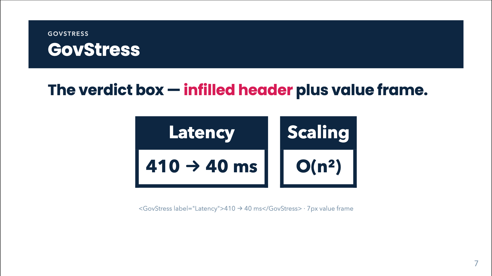

# GovStress



## Overview

`GovStress` is the **verdict box**: a filled navy header band (the label) sitting on a thick-bordered white value box. It is for the two to four claims a talk exists to defend, such as a headline number, a key finding or the question of the section. It is large (2.2rem text) and meant to dominate its slide.

Without a label it becomes a **headless solo box** with a heavy navy top rule, useful for a full-sentence statement or a question. `inverted` flips the value box to navy fill with white text, the [GovBox](gov-box.html) counterpart.

Not for small labels or nodes (use [GovBox](gov-box.html)) nor for popped-up asides (use [GovWindow](gov-window.html)).

## Quick start

<!-- demo: gov-stress-quick-start -->
```html
<GovStress label="Latency">410 → 40 ms</GovStress>
```

## Props

| Prop | Type | Default | Description |
|---|---|---|---|
| `label` | `string` | none | Header band text (HTML / `$…$` LaTeX). Absent or blank (and no `#label` slot) makes the box headless (`gov-stress--solo`). |
| `value` | `string` | none | Body text (HTML / `$…$` / `$$…$$` LaTeX). Ignored when the default slot is used. |
| `inverted` | `boolean` | `false` | Navy fill and white text in the body; the header band flips to white with navy text. |

## Slots

| Slot | Description |
|---|---|
| default | The value. Replaces `value`; not LaTeX-typeset, so write inline HTML. |
| `label` | The header content. Its presence (even with no `label` prop) enables the header band. Not LaTeX-typeset. |

## Feature guides

### Labelled box

<!-- demo: gov-stress-labelled-box -->
```html
<GovStress label="Scaling">O(n²) → O(n)</GovStress>
<GovStress label="Latency" value="410 → 40 ms" />
```

### Headless solo box with LaTeX

<!-- demo: gov-stress-headless-solo-box-with-latex -->
```html
<GovStress value="How do we acquire <br> $\mathbf{\Psi}$ and $\mathbf{\Lambda}$ of $\mathbf{A}$ <br> without constructing $\mathbf{A}$?" />
```

The solo box gets a 7px navy top border and a 1.6rem body size so a sentence fits. Use single backslashes in plain attributes, doubled in bound ones.

### Inverted

<!-- demo: gov-stress-inverted -->
```html
<GovStress inverted value="Can we model <u>nonlinear</u> dynamics?" />
```

The ACL talk uses `<GovStress v-click.fade-in="7" inverted value="…" />` for the key question.

### Coloured words in the value

Wrap words in `gov-stress-value--red`, `--green` or `--blue`:

<!-- demo: gov-stress-coloured-words-in-the-value -->
```html
<GovStress value="Issue: <span class='gov-stress-value--red'>O(n²)</span>" inverted />
```

These three colours are **light tints** (`#f3a9c3`, `#a3d8cb`, `#b7c7dd`) chosen to read on a navy fill, so use them with `inverted` (or on the navy header). On the default white body they are faint.

### Custom label content

<!-- demo: gov-stress-custom-label-content -->
```html
<GovStress>
  <template #label>Latency <small>(p95)</small></template>
  410 → 40 ms
</GovStress>
```

## Animation, click behaviour and print

No animation of its own: it is visible immediately. Reveal it with Slidev's directive, e.g. `v-click`, `v-click.fade-in="7"`. Print / PDF renders it as is.

## Styling hooks

| Class / variable | Role |
|---|---|
| `.gov-stress` | Root, `margin: 0.9rem 0`. |
| `.gov-stress-head` | Navy header band, white bold 2.2rem text, centred. |
| `.gov-stress-body` | White body with 7px navy border (no top), bold 2.2rem, centred. |
| `.gov-stress--solo` | Headless variant: top border 7px navy, body 1.6rem. |
| `.gov-stress--inverted` | Navy body / white text; white header with navy text. |
| `.gov-stress-value--red`, `--green`, `--blue` | Light value tints for navy backgrounds. |
| `--navy` | Header, border and inverted fill. |

Resize with a wrapper or your own rule, e.g. `.gov-stress-body { font-size: 1.8rem; }`.

## Common mistakes

- **Expecting LaTeX in slot content.** Only the `label` and `value` props are typeset. Slot content is raw.
- **Using the value tints on a white body.** They are too light; combine with `inverted`.
- **A blank label for alignment.** `label=""` (or whitespace) produces the solo box with its heavy top rule, not an empty header band.
- **Too many on one slide.** The box is deliberately loud; one or two per slide.
- **Single backslashes in a bound prop** (`:value="'$\mathbf{A}$'"`). Double them.
