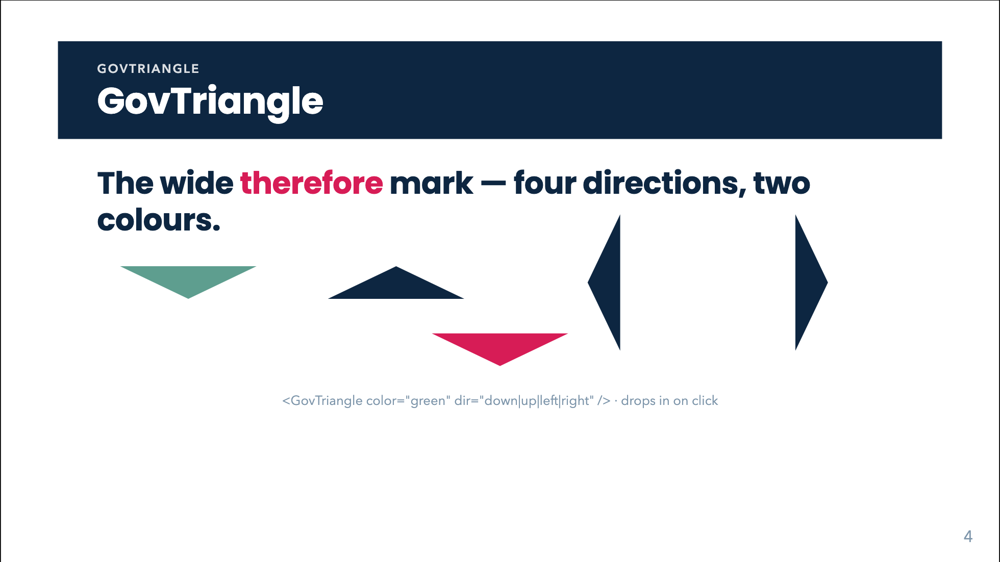

# GovTriangle



## Overview

`GovTriangle` is the wide **"therefore" mark** (a broad ▼). It says "what is above implies what is below". It is the connective of an argument, never of a data flow: do not put it inside a [GovPipe](gov-pipe.html) (use [GovArrow](gov-arrow.html) for data).

Its colour carries the verdict: navy for a neutral implication, green (sage) for a positive consequence, red (crimson) for a negative one. Rotating it (`dir`) turns the implication into an upward, leftward or rightward one. An optional `label` puts the *condition* of the implication on a white plate centred on the triangle ("When $n$ is large").

Most of the time you want [GovChain](gov-chain.html), which places boxes and text above and below the triangle for you and reveals them together. Use `GovTriangle` directly when you are composing the layout by hand.

## Quick start

```html
<GovTriangle />
<GovTriangle color="green" label="When $n$ is large" animated />
```

## Props

| Prop | Type | Default | Description |
|---|---|---|---|
| `color` | `'navy' \| 'green' \| 'red'` | `'navy'` | Fill colour (navy `--navy`, green `--sage`, red `--crimson`). |
| `dir` | `'down' \| 'up' \| 'left' \| 'right'` | `'down'` | Pointing direction. `up` / `left` / `right` rotate the shape (180, 90, -90 degrees). |
| `animated` | `boolean` | see note | `true`: wrapped in `v-click`, drops in on the next click. `false`: plain, always visible. |
| `label` | `string` | none | Annotation rendered as HTML and `$…$` / `$$…$$` LaTeX on a white plate with a navy outline, centred on the triangle. |

Note on `animated`: the source comment says "default true", but the prop is declared as a plain `boolean`, and Vue casts an absent boolean prop to `false`. As the code stands, a bare `<GovTriangle />` is **not** animated. Write `animated` (or `:animated="true"`) to get the click-drop, and `:animated="false"` for the static form. (GovChain always passes `:animated="false"` and animates its own wrapper.)

The props are read once when the component is set up (the class strings are not reactive), so changing `color` / `dir` after mount does not restyle it.

## Slots

None.

## Feature guides

### Colours

```html
<GovTriangle />
<GovTriangle color="green" />
<GovTriangle color="red" />
```

### Direction

```html
<GovTriangle dir="up" />
<GovTriangle dir="left" />
<GovTriangle dir="right" />
```

Horizontal triangles are rotated from a wide layout box; the stylesheet compensates with negative margins (`-5.5rem` on the labelled form), so they sit tight against neighbours in a flex row.

### Labelled triangle (the condition)

```html
<GovTriangle label="When $n$ is large" />
<GovTriangle color="red" label="When the state dimension is very large" />
```

For a vertical triangle the labelled form is a fixed 14rem x 4.5rem shape with the plate centred on the centroid (one third down from the base; two thirds for `dir="up"`). The plate wraps at `10.5rem` and may spill past the slanted sides, which is intended. For `dir="left"` / `"right"` the label is centred inside the rotated band and wraps at 4.4rem, so keep it very short (a symbol like `$\Rightarrow$` or one word).

The label is typeset with KaTeX; write single backslashes in a plain attribute and doubled ones when binding (`:label="'$\\alpha > 1$'"`).

### Animated drop

```html
<GovTriangle animated label="Therefore" />
```

## Animation, click behaviour and print

With `animated`, the triangle (or the label tag around it) carries `v-click` plus Slidev's `slidev-vclick-anim-down`, and drops 2rem (0.1s ease-out) into place on the next click. Without it, there is no click and no motion. In print / PDF export (`@media print`) the transition and translate are disabled and the final state is shown; hidden click elements are shown as usual by Slidev's print mode.

Inside a [GovChain](gov-chain.html) the triangle is rendered with `:animated="false"` and the surrounding `.gov-chain-tail` provides the reveal.

## Styling hooks

| Class | Role |
|---|---|
| `.gov-therefore` | The triangle itself (CSS border triangle, 4.2rem half-width, 2rem high). |
| `.gov-therefore--red`, `--green` | Colour variants. |
| `.gov-therefore--up`, `--left`, `--right` | Rotations. |
| `.gov-therefore--sm` | Compact square-ish variant used by GovChain for side branches (only effective as a direct child of `.gov-chain-tail`). |
| `.gov-therefore-tag` | Wrapper used when `label` is set; `--up`, `--left`, `--right`, `--green`, `--red` suffixed variants exist (the colour variants are applied to the inner `.gov-therefore`). |
| `.gov-triangle-label` | The label plate: white fill, 3px navy outline, 1rem text, `max-width: 10.5rem`. |
| `--navy`, `--sage`, `--crimson` | Colours. |

## Common mistakes

- **Assuming it animates by default.** See the note above: pass `animated`.
- **`animated="false"` as a string.** A string `"false"` is truthy in Vue's boolean casting; bind it: `:animated="false"`.
- **Using it in a data pipeline.** It is a logical connective, not a data arrow.
- **Long labels on horizontal triangles.** The horizontal band is only 4.4rem wide; long text overflows it.
- **Expecting `dir` to move the content.** `dir` only rotates the mark; `GovTriangle` has no content above or below it.
