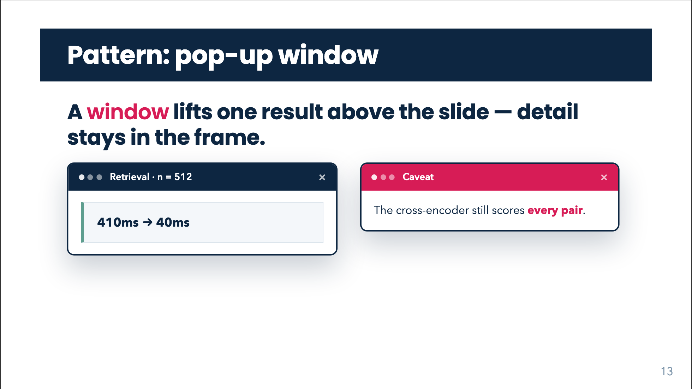

# GovWindow



## Overview

`GovWindow` is a **floating pop-up window** with chrome: a coloured title bar (three dots, title, close glyph), a body and an optional footer. It pops in on click with a fade and a small scale and translate. Use it for a result, a quote, a screenshot or a caveat that should feel layered *above* the slide rather than part of it. The bar colour signals tone: navy for neutral, green for a positive result, red for a caveat.

With `overlay`, the window is centred on the slide and the slide behind is dimmed, so it takes "the whole floor". Use sparingly. For a headline claim use [GovStress](gov-stress.html); for an inline label use [GovBox](gov-box.html).

## Quick start

```html
<GovWindow title="Search result">410 → 40 ms</GovWindow>
```

## Props

| Prop | Type | Default | Description |
|---|---|---|---|
| `title` | `string` | none | Text in the title bar (HTML / LaTeX). Also used as the dialog's `aria-label` (raw string). |
| `body` | `string` | none | Body text (HTML / LaTeX). The default slot overrides it. |
| `footer` | `string` | none | Footer text (HTML / LaTeX). The `#footer` slot overrides it. The footer renders only when this or the slot is present. |
| `tone` | `'navy' \| 'green' \| 'red'` | `'navy'` | Colour of the title bar. |
| `width` | `string` | `'30rem'` | CSS width of the window (capped at 100% of its container). |
| `overlay` | `boolean` | `false` | Dim the slide behind the window and centre the window on the slide (fixed layer). |
| `closable` | `boolean` | `true` | Show the `×` glyph in the bar. Purely decorative: it has no click handler. |

## Slots

| Slot | Description |
|---|---|
| default | Window body. Replaces `body`; raw (not LaTeX-typeset). |
| `title` | Replaces the `title` prop in the bar. |
| `footer` | Replaces the `footer` prop. |

## Feature guides

### Tones

```html
<GovWindow title="Result" tone="green">410 → 40 ms</GovWindow>
<GovWindow title="Caveat" tone="red">The cross-encoder still scores every pair.</GovWindow>
```

### Width and side by side

```html
<div class="grid grid-cols-2 gap-6">
  <GovWindow title="Retrieval · n = 512" width="25rem">410 ms → 40 ms</GovWindow>
  <GovWindow title="Caveat" tone="red" width="23rem">Still scores <b>every pair</b>.</GovWindow>
</div>
```

Each window takes its own click.

### Overlay

```html
<GovWindow title="Caveat" tone="red" overlay>
  The cross-encoder still scores every pair.
</GovWindow>
```

With `overlay` the layer is `position: fixed; inset: 0; z-index: 40` with a 30% navy backdrop, so the window is centred on the slide regardless of where it is written.

### Title, body and footer with LaTeX

```html
<GovWindow title="Eigenvalues of $\mathbf{A}$" body="$$\lambda_k = e^{(\alpha_k + i\beta_k)\Delta t}$$" footer="Source: Section 3, Eq. (2)" />
```

### Rich content and footer slot

```html
<GovWindow title="Result" width="34rem">
  <GovStress label="Latency">410 → 40 ms</GovStress>
  <template #footer>Source: internal benchmark</template>
</GovWindow>
```

Nested `.gov-box` / `.gov-stress` have their margin zeroed inside the window body.

### Hiding the close glyph

```html
<GovWindow title="Note" :closable="false">…</GovWindow>
```

Bind the boolean (`:closable="false"`, `:overlay="true"`). A plain string `closable="false"` is not the boolean.

## Animation, click behaviour and print

The window layer is the `v-click` root, so **one click reveals one window**. The window fades from opacity 0 while rising 1.25rem and scaling from 0.94 (0.3s linear); the overlay backdrop fades with it. Windows are revealed in DOM order with the rest of the slide's clicks, and you may use `v-click` modifiers/anchors through the usual Slidev mechanisms on a wrapper.

In print / PDF the window is shown in its final state: transitions and shadow are removed, the backdrop is hidden, and an `overlay` layer becomes a static block (`position: static`) in the page flow, so it prints in place instead of covering the page. Under `prefers-reduced-motion: reduce` the transitions are disabled.

## Styling hooks

| Class / variable | Role |
|---|---|
| `.gov-window-layer` | The click root (flex, centred, full width). `--overlay` modifier makes it fixed and full-slide. |
| `.gov-window-backdrop` | Dimming backdrop (overlay only), `rgba(13,38,65,0.3)`. |
| `.gov-window` | The window: `--paper` background, 2px navy border, `--radius` corners, shadow. Width is `min(var(--gw-width, 30rem), 100%)`; `--gw-width` is set inline from `width`. |
| `.gov-window--navy`, `--green`, `--red` | Tone class on the window (green and red recolour the bar). |
| `.gov-window-bar` | Title bar (navy, white text). |
| `.gov-window-dots`, `.gov-window-title`, `.gov-window-close` | Decorative dots, the title (single line with ellipsis) and the `×`. |
| `.gov-window-body` | Body: padding `1rem 1.1rem`, scrolls if taller than the window. |
| `.gov-window-footer` | Footer: top rule in `--line`, steel text, 0.8rem. |
| `--navy`, `--sage`, `--crimson`, `--paper`, `--steel`, `--line`, `--radius` | Theme variables. |

## Common mistakes

- **Expecting the × to close the window.** It is decorative; the window is dismissed by moving on in the click sequence (or never, in a static export).
- **Several windows in one place without thinking about clicks.** Each is a separate click and they stack unless you place them apart.
- **`overlay` on a slide with other click content.** The backdrop dims everything beneath; reveal it as the last click of the slide.
- **LaTeX in slot content.** Only `title`, `body` and `footer` props are typeset.
- **Long titles.** The title is one line and is truncated with an ellipsis.
- **Boolean props as strings** (`overlay="false"`). Bind them.
