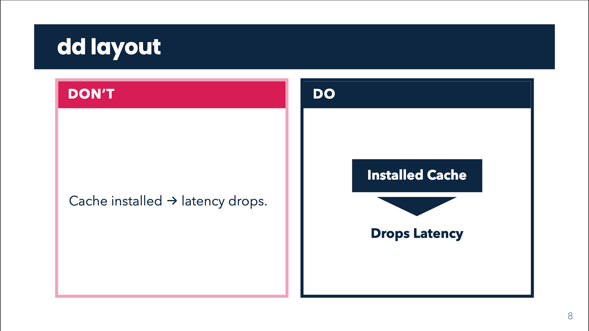

# Layouts

The kit ships eight slide layouts (`template/layouts/*.vue`) and one global
layer (`template/global-bottom.vue`). Pick one per slide with the `layout:` key
in that slide's frontmatter. All titles go through `typeset()`, so `$...$`
LaTeX and inline HTML (`<strong>`, `<br>`) work in `title`, `lead` and
`subtitle`.

| Layout | Use it for | Keys read |
| --- | --- | --- |
| [`govuk`](#govuk) | the default content slide: band, lead, evidence, aside | `title`, `kicker`, `bandColor`, `lead`, `centered` |
| [`govuk-cover`](#govuk-cover) | title slide | `title`, `subtitle`, `name`, `jpTitle`, `meta`, `author` |
| [`govuk-about`](#govuk-about) | self-introduction | `image`, `title` |
| [`govuk-section`](#govuk-section) | section divider with a progress rail | `title`, `subtitle`, `kicker`, `sections` |
| [`govuk-two-cols`](#govuk-two-cols) | argument left, evidence right | `title`, `kicker`, `bandColor`, `lead` |
| [`govuk-image-right`](#govuk-image-right) | text left, figure right | `title`, `kicker`, `bandColor`, `image` |
| [`govuk-end`](#govuk-end) | closing slide | `title`, `subtitle`, `kicker`, `author` |
| [`dd`](#dd) | Don't / Do pair | `title`, `kicker`, `bandColor` |

Never write `# Heading` inside a layout: the band already renders `title`, and
`scripts/lint-deck.py` flags the duplicate.

## Deck headmatter

The first slide's frontmatter doubles as the deck's headmatter. Global keys
used in `template/slides.md`:

```yaml
---
theme: default              # the kit styles everything itself
colorSchema: light          # the theme forces a white ground even in dark mode
title: 'Canonical Template Deck'   # deck title (also the cover title)
layout: govuk-cover         # the first slide is the cover
mdc: true                   # MDC syntax in markdown
highlighter: shiki
drawings:
  persist: false
transition: slide-left      # acl26-talk uses fade-out
lineNumbers: false
info: |                     # free text shown in Slidev's overview
  Canonical template deck.
# optional
deckFooter: false           # hide the page number everywhere (see below)
clickAnimation: fade-in     # used by acl26-talk
---
```

Cover keys (`subtitle`, `name`, `jpTitle`, `meta`, `author`) sit in the same
block, because the first slide is the cover. See
[govuk-cover](#govuk-cover).

## govuk

The workhorse. Reading order is enforced by the layout:

1. band title (`title`, with optional `kicker` eyebrow)
2. the lead / takeaway (`lead`), rendered as `<h2 class="govuk-lead">`
3. the evidence (default slot)
4. secondary material (`#aside` slot, greyed with a hairline above)

| Key | Effect |
| --- | --- |
| `title` | band title. If absent the band is not rendered. LaTeX / HTML allowed |
| `kicker` | small uppercase eyebrow above the title |
| `bandColor` | `black` (default, navy in this theme), `blue` (navy), `green` (sage), `red` (crimson) |
| `lead` | the one focal sentence (1.6rem bold). `<strong>` renders crimson |
| `centered` | `true` vertically centres the body (undocumented elsewhere; read by `govuk` only) |

Slots: default (body), `#aside`.

<!-- demo: layouts-govuk -->
```md
---
layout: govuk
kicker: 'METHOD'
title: 'MBR decoding scales as O(n²)'
lead: 'Utility replaces hand-tuned metrics, but you pay for <strong>every pair</strong>.'
---

<ol class="govuk-steps">
  <li>Hypothesis encoding</li>
  <li>Pseudo-reference encoding</li>
  <li>Score matrix</li>
</ol>

<template #aside>
  Baselines: BEURT (O(n²)), SimCSE (O(n)).
</template>

<!-- Speaker notes: the script for this slide. -->
```

Notes: `lead` is mandatory for `govuk` (lint error). The lint does not
currently require it on `govuk-two-cols` / `govuk-image-right`, though the
doctrine does.

## govuk-cover

Title page: navy band with the title (white, bold, wraps to two lines), a sage
band with the subtitle, then name, an optional Japanese (or other) title, and
grey meta lines at the foot.

| Key | Effect |
| --- | --- |
| `title` | band title. LaTeX / HTML allowed |
| `subtitle` | sage band under the title. Omit to drop the band |
| `name` | presenter name (plain text, navy) |
| `jpTitle` | large secondary-language title (plain text) |
| `meta` | grey lines, **raw HTML** (`<br>` for line breaks), not typeset |
| `author` | affiliation line below `meta` (plain text) |

The default slot renders at the bottom of the body, if you need extra content.
The page number is hidden on this layout.

<!-- demo: layouts-govuk-cover -->
```md
---
layout: govuk-cover
title: 'Extrapolative Diachronic Language Modelling'
subtitle: 'Towards Future Text Generation'
name: 'Tomoyuki Jinno (D1)'
jpTitle: '外挿型通時態言語モデル'
meta: 'Regular Meeting<br>30 October 2026'
author: 'Watanabe Laboratory, NAIST'
---

<!-- Opening remarks. -->
```

## govuk-about

Self-introduction: full-bleed photo on the left (11/20 of the width), navy
panel on the right with an underlined white title and the slide's bullets.

| Key | Effect |
| --- | --- |
| `image` | photo URL or `/file.jpg` in `public/` (see [Image in public/](#image-in-public)). Without it the photo `div` is not rendered and the panel falls into the wider left grid column, so always set it |
| `title` | panel title, default `About Me` |

Slot: default (bullets). Inside this layout `<span class="accent-amber">` is
styled amber; the class is scoped to this layout (see
[styling](styling.md#emphasis-spans)).

<!-- demo: layouts-govuk-about -->
```md
---
layout: govuk-about
title: 'About Me'
image: /about.jpg
---

- **Presenter Name** (D1)
  * From City, Country
- **Research Interests**:
  * Topic one
  * <span class="accent-amber">Topic two</span>
- **Hobbies**: one, two

<!-- Self-introduction script. -->
```

## govuk-section

Full-bleed navy divider with the title lower-left, a grey subtitle, and a
progress rail of **all** sections on the right edge.

| Key | Effect |
| --- | --- |
| `title` | big white title. LaTeX / HTML allowed |
| `subtitle` | grey line under the title |
| `kicker` | the **1-based section number**. It is parsed as an integer and indexes into `sections`; it is not displayed as text here |
| `sections` | list of all section names; renders the rail |

In the rail the current section is white with a sage square, earlier sections
are dimmer, later ones dimmest. The page number turns translucent white on
this layout. Dividers are the one slide type that needs no speaker notes.

<!-- demo: layouts-govuk-section -->
```md
---
layout: govuk-section
kicker: '2'
title: 'Approach'
subtitle: 'Language evolution as a dynamical system'
sections:
  - Motivation
  - Approach
  - Method
  - Results
---
```

Notes:

- Repeat the **same `sections:` list on every divider**, otherwise the rail
  changes between dividers. Only `kicker` differs.
- With no `sections`, no rail is drawn.
- The title block is capped so long titles clear the rail.

## govuk-two-cols

Two columns with enforced roles: the left column is the **argument**
(statements, findings), the right column is the **evidence** (numbers, figure,
code). Use it only when the roles are clear; otherwise prefer `govuk`.

Keys: `title`, `kicker`, `bandColor` (default `black`), `lead` (same as
[govuk](#govuk)). Slots: default (left), `::right::` (right).

<!-- demo: layouts-govuk-two-cols -->
```md
---
layout: govuk-two-cols
title: 'Method vs baseline'
lead: 'The linear model matches the baseline at <strong>one tenth</strong> of the cost.'
---

- Same data, same budget
- One matrix multiply per step

::right::

<div class="gov-bignum gov-bignum--good">
  <span class="gov-bignum-n">10x</span>
  <span class="gov-bignum-label">cheaper</span>
</div>

<!-- Notes. -->
```

Note: there is no `#aside` slot on this layout.

## govuk-image-right

Text on the left (1fr), figure on the right (1.1fr) with a hairline border.

| Key | Effect |
| --- | --- |
| `title`, `kicker`, `bandColor` | band as in [govuk](#govuk) (default `black`) |
| `image` | figure URL or `/file.png` in `public/` |

Slots: default (text), `#caption` (rendered under the image, **only when
`image` is set**), and `::right::` (rendered **only when `image` is not set**,
e.g. for a component or a chart). The layout does not render a `lead`; if you
want a lead on this layout, put `<h2 class="govuk-lead">...</h2>` at the top
of the body, or use the template's pattern slide, which still sets `lead:` for
the linter.

<!-- demo: layouts-govuk-image-right -->
```md
---
layout: govuk-image-right
title: 'Pattern: figure slide'
image: /results.png
---

- The figure is the evidence
- Provenance goes in the caption

<template #caption>
  <p class="govuk-caption">Fig. 1: validation loss by year.</p>
</template>

<!-- Say what the figure proves and its source. -->
```

## govuk-end

Closing slide, mirroring the cover: navy band with the thanks, sage band with
the questions line, then a kicker and author on white. The page number is
hidden.

| Key | Effect |
| --- | --- |
| `title` | band text, default `Thank you` |
| `subtitle` | sage band (e.g. `Questions?`) |
| `kicker` | bold navy line under the bands; used for the contact / repo link |
| `author` | grey affiliation line |

<!-- demo: layouts-govuk-end -->
```md
---
layout: govuk-end
title: 'Thank you'
subtitle: 'Questions?'
kicker: 'github.com/your-repo'
author: 'Laboratory · @yourhandle'
---

<!-- Closing remarks. -->
```

## dd

A **Don't / Do** pair slide for teaching a rule: the wrong version on the
left, the right one on the right. The pair is the focal point, so there is no
`lead`. Keep the band title to four words or fewer.



| Key | Effect |
| --- | --- |
| `title` | band title (no band if absent) |
| `kicker` | eyebrow above the title |
| `bandColor` | `blue` (default), `black`, `green`, `red` |

The layout has **no named slots**. Pairs are plain markup in the default slot,
using the `.dd` classes from `style.css`:

| Class | Role |
| --- | --- |
| `dd` | two-column grid filling the body |
| `dd-card dd-bad` / `dd-card dd-good` | the cards (crimson-tinted vs navy border) |
| `dd-head` | uppercase header strip (crimson for bad, navy for good) |
| `dd-body` | card content, vertically centred, 1.4rem |
| `dd-caption` | grey caption under content |
| `mock-title`, `mock-sub` | title and sub line for mocked-up slide content |
| `quad`, `quad-box`, `twin`, `twin-col`, `dd-big-quad` | helpers for deliberately bad examples (four equal boxes, twin columns) |
| `w-red`, `w-green`, `w-blue`, `w-amber` | word-colour abuse, for the Don't side only |

<!-- demo: layouts-dd -->
```md
---
layout: dd
bandColor: blue
title: 'Installed Cache'
---

<div class="dd">
  <div class="dd-card dd-bad">
    <div class="dd-head">Don’t</div>
    <div class="dd-body">Cache installed → latency drops.</div>
  </div>
  <div class="dd-card dd-good">
    <div class="dd-head">Do</div>
    <div class="dd-body">
      <GovChain top-box="Installed Cache" bottom="Drops Latency" />
    </div>
  </div>
</div>

<!-- Why the left version fails and the right one works. -->
```

Inside `.dd-body` the diagram primitives (`gov-flow`, `gov-node`, `gov-io`,
`gov-bignum`, `govuk-steps`) are resized to fit the half-width card.

## global-bottom.vue

Slidev's global bottom layer renders the **page number**, bottom-right, on
every slide.

- Grey (`--govuk-secondary`, steel) on light slides.
- Translucent white on `govuk-section` (navy).
- **Hidden** on `govuk-cover` and `govuk-end`.
- Disable everywhere with `deckFooter: false` in the headmatter.

It prints `$nav.currentSlideNo` directly instead of `<SlideCurrentNo />`,
which numbers every page "1" in per-slide print and export renders. Do not
replace it. Keep `--per-slide` on export commands.

The `gov-settings` footer (a one-line run configuration, see
[styling](styling.md#settings-footer)) sits to the left of the page number.

## Image in public/

Files in the deck's `public/` directory are served from `/`. Reference them
with a leading slash and **without** `public/`:

```yaml
image: /about.jpg      # file is public/about.jpg
```

`image:` in `govuk-about` and `govuk-image-right` goes through Slidev's
`resolveAssetUrl`, so absolute URLs (`https://cover.sli.dev`) also work. For
images inside the body use ``.
