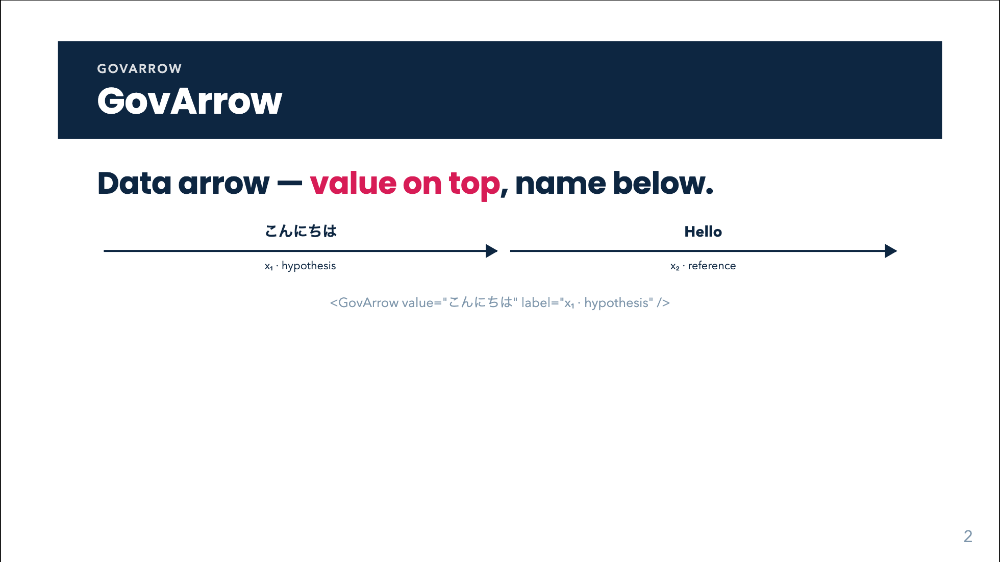
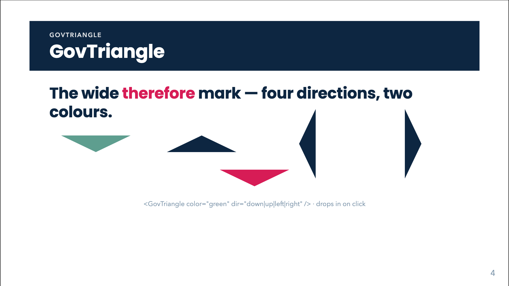
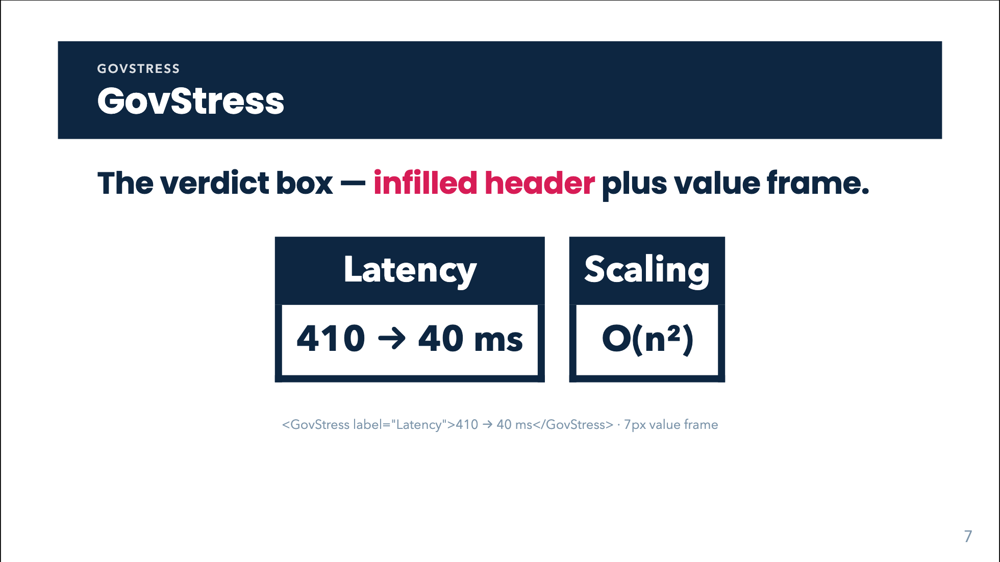

# Component cookbook

Every runnable component in `template/components/`: what it does, how to call
it, and (in `img/`) a rendered frame from a real deck. All animations trigger
on click at the component level — no per-slide wiring needed — and static
exports always show the settled state.

The style contract lives in `template/style.css` (Quiet theme: navy `#0D2641`
ink, crimson `#D71C56` reserved for the one keyword, Poppins, white ground).
To change how a component looks, change the CSS class — never the component.

---

## GovArrow — data arrow

Data moves through the pipeline; the **example value rides on top of the
arrow**, the name/explanation sits **below in ink**. Values are never boxed.

```html
<GovArrow value="こんにちは" label="x₁ · hypothesis" />
<GovArrow value="Hello" label="x₂ · reference" />
```

| | |
|---|---|
| props | `value` (top, any text/HTML), `label` (below, any text/HTML) |
| slots | `#value`, `#label` — override with rich markup |
| animation | slides in from the left, 0.3s linear |
| use when | any input→output flow between stages |



---

## GovBox — filled label block

```html
<GovBox label="Installed Cache" />
<GovBox inverted label="Installed Cache" />
<GovBox label="$$\mathbf{A} \in \mathbb{C}^{n \times n}$$" />
```

| | |
|---|---|
| props | `label` (HTML / `$…$`, `$$…$$` LaTeX — typeset via KaTeX); `inverted` (default fill navy → white fill + navy outline/ink) |
| slots | default — replaces the label text |


---

## GovTriangle — the "therefore" mark

The wide ▼ that carries a conclusion. Never sits inside a data pipeline —
arrow = data, triangle = therefore.

```html
<GovTriangle />                              <!-- navy, pointing down -->
<GovTriangle color="green" dir="down" />     <!-- positive verdict -->
<GovTriangle color="red" />                  <!-- negative verdict -->
<GovTriangle dir="up" /> · <GovTriangle dir="left" /> · <GovTriangle dir="right" />
<GovTriangle label="When $n$ is large" />    <!-- annotation above the ▼ -->
```

| | |
|---|---|
| props | `color`: `navy` (default) / `green` / `red`; `dir`: `down` (default) / `up` / `left` / `right`; `animated` (default `true`); `label` — HTML / `$…$`, `$$…$$` LaTeX annotation rendered just above the ▼ |
| animation | drops in top→bottom on click (`animated="false"` renders it plain for chains) |



---

## GovChain — block → triangle → consequence

The bottom-line verdict, chainable. On one click the tail fades in while the
triangle slides down to meet the bottom text.

```html
<GovChain top-box="Installed Cache" bottom="Drops Latency" />
<GovChain top="<b>Installed Cache</b>" bottom="Drops <u>Latency</u>" color="green" />
<GovChain top-box="$$\mathbf{A} \in \mathbb{C}^{n \times n}$$" bottom="Drops Latency" />
<GovChain top-box="Cache hit" bottom="Drops Latency" label="When $n$ is large" />
<GovChain
  :steps="[
    { topBox: 'Installed Cache',      bottom: 'Drops Latency' },
    { top: '<b>Free of LLM calls</b>', bottom: 'Scales linearly' },
  ]" color="green" />
```

| | |
|---|---|
| props | `top` (HTML / LaTeX), `topBox` (renders `GovBox` instead), `bottom` (HTML / LaTeX), `label` (annotation on the triangle, HTML / LaTeX), `color`, `steps` (array of the above — chains any number). Top and bottom text also accept `$…$` / `$$…$$` LaTeX, typeset via KaTeX |
| slots | `#top`, `#bottom` — full custom markup for either end |
| animation | one click per step: tail fades, triangle slides, bottom arrives with it |


---

## GovPipe — N inputs → stage → M outputs

```html
<GovPipe
  :inputs="[
    { value: 'こんにちは', label: 'x₁ · hypothesis' },
    { value: 'Hello',     label: 'x₂ · reference' },
  ]"
  :outputs="[
    { value: 'Hello', label: 'ŷ · output' },
  ]">
  <template #stage>
    <span class="gov-node gov-node--icon">
      <carbon:filter class="gov-node-icon" />
      <span class="gov-node-sub">select min</span>
    </span>
  </template>
</GovPipe>
```

| | |
|---|---|
| props | `inputs`, `outputs` — arrays of `{ value, label }`, any cardinality; `stageBox` — renders a `GovBox` as the stage instead of the slot |
| slots | `#stage` — icon-with-name **or any markup** (box, chip); `#inputs`/`#outputs` — full custom arrows |
| animation | arrows inherited from `GovArrow` |


---

## GovStress — the verdict box

The infilled-header textbox: navy header band with the label, thick value frame
below. Use for the 2–4 claims a deck exists to defend.

```html
<GovStress label="Latency">410 → 40 ms</GovStress>
<GovStress label="Scaling">O(n²)</GovStress>
```

| | |
|---|---|
| props | `label` (header band, white text); default slot = the value (bold, large) |



---

## GovDerivation — animated equation morphs

3Blue1Brown-style equation transformations. Each click morphs the equation one
step: tokens that survive fly to their new position (FLIP), new tokens fade in
flashed crimson, removed tokens drift away — Manim's `TransformMatchingTex`,
in the browser.

```html
<GovDerivation
  :steps="[
    'ax^2 + bx + c = 0',
    { tex: 'x^2 + \\frac{b}{a}x = -\\frac{c}{a}', note: 'divide by a, move the constant' },
  ]"
/>
```

| | |
|---|---|
| props | `steps` — array of LaTeX strings or `{ tex, note }` (`note` renders under the equation, changes per step; `$…$` spans inside the note render as inline math, e.g. `'Apply $\\mathbf{X}^\\dagger$ on both sides'`); `duration` (ms, default 700); `size`: `md` / `lg` / `xl`; `showProgress` (dots, default `true`); `showHistory` (ledger of completed steps below the equation, default `true`); `historySize` — stacked-equation font size, number = em multiplier of the equation size (default `0.58`), string = raw CSS length (`'0.8rem'`); `historyOpacity` — stacked-equation opacity, 0–1 (default `1`); `morphMap` — `{ tokenTex: canonicalId }`: tokens sharing a canonical id morph into each other (in order of appearance) instead of fading apart |
| animation | one morph per click / arrow-key advance — the component registers one click slot per morph on the slide's click context at mount (in DOM order, so v-click elements placed before it keep the earlier clicks); each completed step is written below the equation as a small ledger line with its note, so the audience can catch up; print & exports show the final step plus the full ledger |
| use when | derivations, reformulations, substitutions — any “watch the algebra work” moment |

---

## The `dd` layout — Don't/Do pairs

For teaching a rule: wrong on the left, right on the right; the pair **is** the
content (no `lead:` duplication). Titles ≤ 4 words.

```yaml
---
layout: dd
bandColor: blue
title: 'Installed Cache'
---
<div class="dd">
  <div class="dd-card dd-bad">
    <div class="dd-head">Don’t</div>
    <div class="dd-body"> … </div>
  </div>
  <div class="dd-card dd-good">
    <div class="dd-head">Do</div>
    <div class="dd-body"> … </div>
  </div>
</div>
```


---

## Creating a new component

Follow the kit's pattern (see any file in `template/components/`):

1. **One SFC per component** in `template/components/` — Slidev auto-imports it
   deck-wide by filename.
2. **Props carry data** (`defineProps<{...}>()`); **slots carry structure**
   (`<slot name="...">` with a prop-driven fallback for the common case).
3. **No styling inside the component** — render semantic classes
   (`.gov-*`) and style those in `template/style.css`, so the theme owns the look.
4. **Animation at the component level**: wrap the root in `<v-click
   class="slidev-vclick-anim-right …">` — Slidev strips static `slidev-vclick-anim-*`
   classes, so either pass the animation via the component `v-click` (`:
   animation="'…'"` on `<v-click>`) or let the wrapper own it (the `GovChain`
   pattern). Transitions for `.gov-io` / `.gov-therefore` are already in
   `style.css`; `@media print` forces the settled state.
5. **Demo contract**: add a slide to `template/slides.md` (showcase, plan row
   included) and re-render this cookbook's `img/` from a scratch deck
   (`new-deck.sh` → demo slide → `export.sh … png` → copy into `img/`).
6. **Gate**: `scripts/lint-deck.py` must stay green on the showcase; run it.
