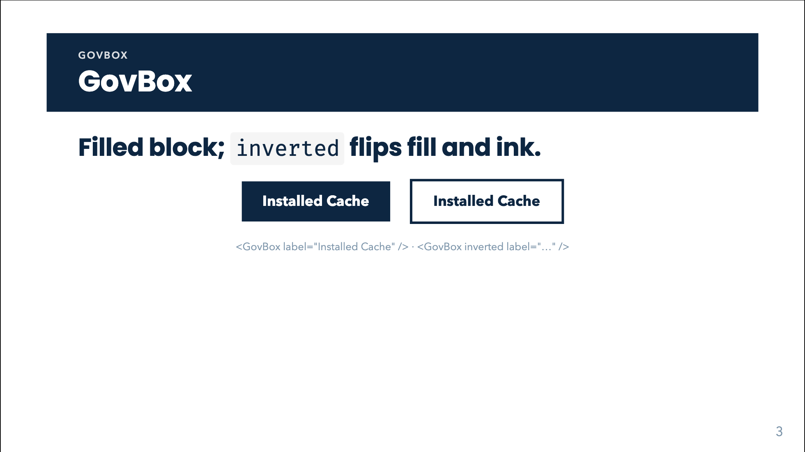
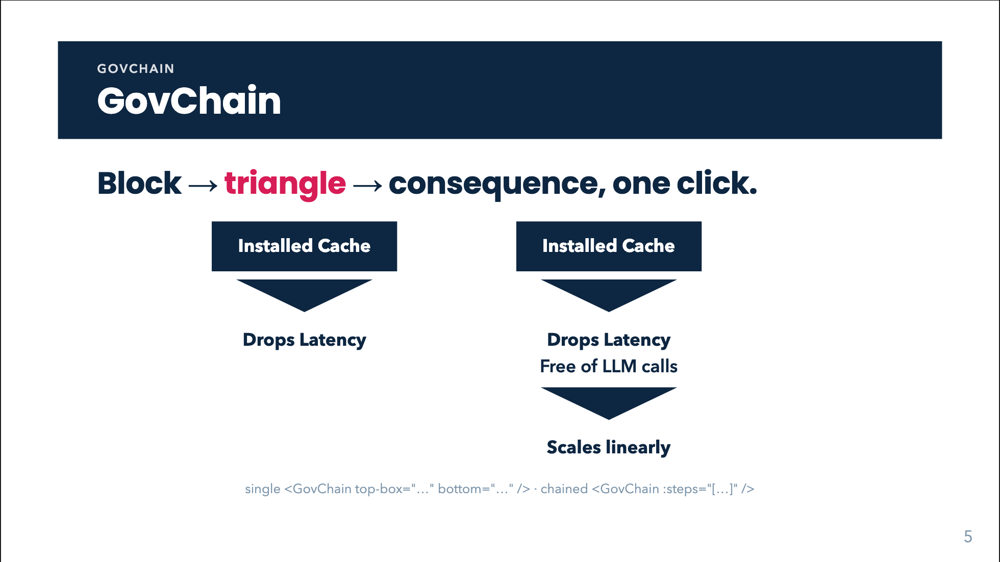
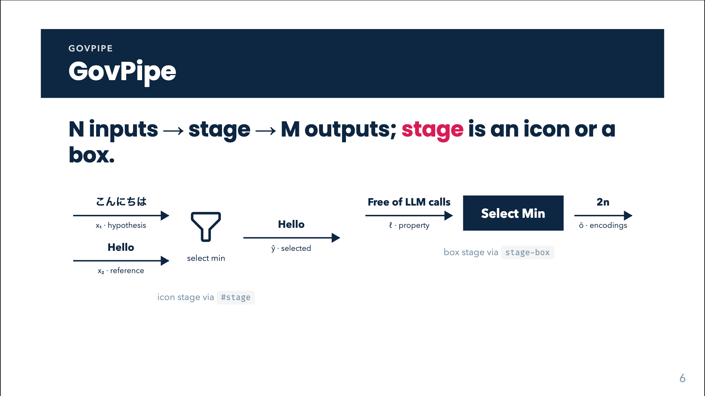
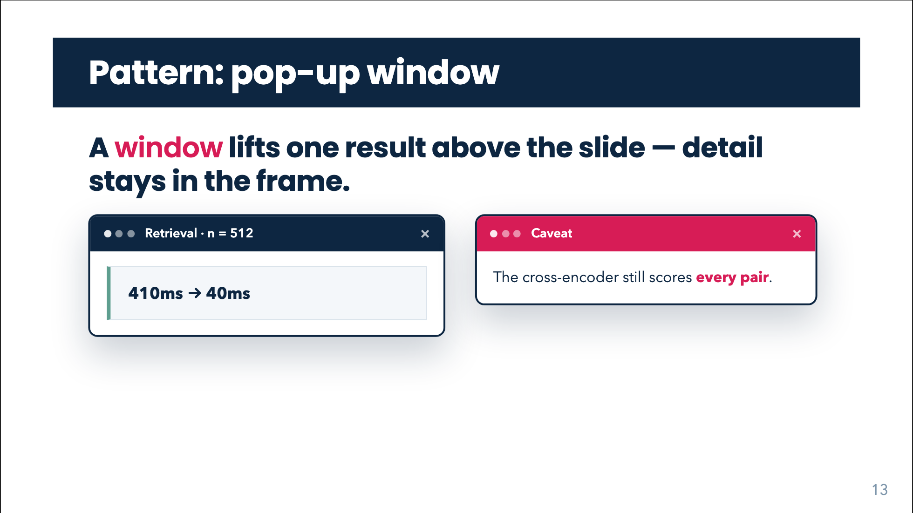
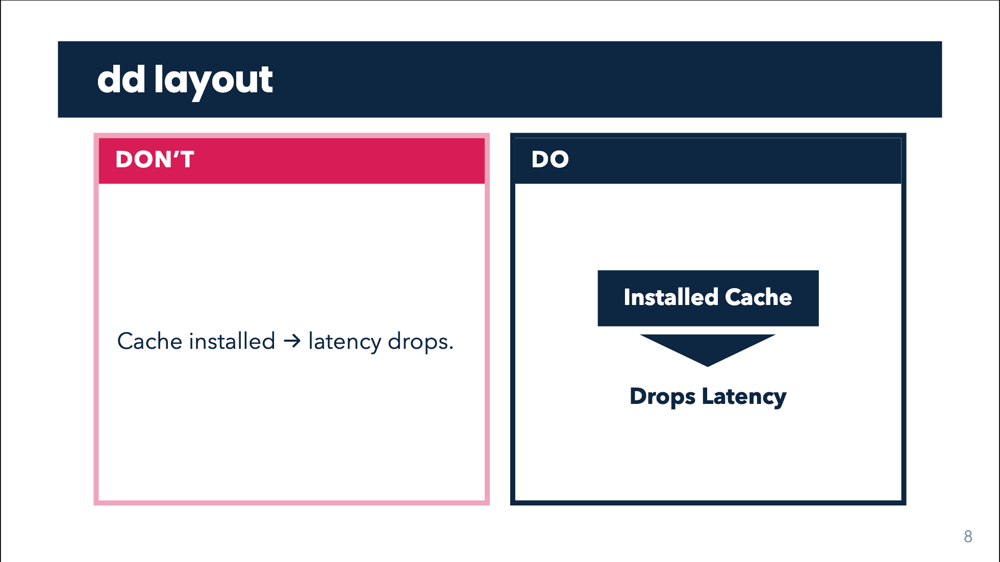

# Component cookbook

Every runnable component in `template/components/`: what it does, how to call
it, and (in `img/`) a rendered frame from a real deck. All animations trigger
on click at the component level — no per-slide wiring needed — and static
exports always show the settled state.

The style contract lives in `template/style.css` (Quiet theme: navy `#0D2641`
ink, crimson `#D71C56` reserved for the one keyword, Poppins, white ground).
To change how a component looks, change the CSS class — never the component.

---

## GovArrow — data arrow

Data moves through the pipeline; the **example value rides on top of the
arrow**, the name/explanation sits **below in ink**. Values are never boxed.

```html
<GovArrow value="こんにちは" label="x₁ · hypothesis" />
<GovArrow value="Hello" label="x₂ · reference" />
```

| | |
|---|---|
| props | `value` (top, any text/HTML), `label` (below, any text/HTML) |
| slots | `#value`, `#label` — override with rich markup |
| animation | slides in from the left, 0.3s linear |
| use when | any input→output flow between stages |


---

## GovBox — filled label block

```html
<GovBox label="Installed Cache" />
<GovBox inverted label="Installed Cache" />
<GovBox label="$$\mathbf{A} \in \mathbb{C}^{n \times n}$$" />
<GovBox label="Small print" size="0.8rem" />
```

| | |
|---|---|
| props | `label` (HTML / `$…$`, `$$…$$` LaTeX — typeset via KaTeX); `inverted` (default fill navy → white fill + navy outline/ink); `size` (number = em multiplier of the inherited size, string = any CSS length) |
| slots | default — replaces the label text |



---

## GovTriangle — the "therefore" mark

The wide ▼ that carries a conclusion. Never sits inside a data pipeline —
arrow = data, triangle = therefore.

```html
<GovTriangle />                              <!-- navy, pointing down -->
<GovTriangle color="green" dir="down" />     <!-- positive verdict -->
<GovTriangle color="red" />                  <!-- negative verdict -->
<GovTriangle dir="up" /> · <GovTriangle dir="left" /> · <GovTriangle dir="right" />
<GovTriangle label="When $n$ is large" />    <!-- white plate with a navy outline, centred on the fill -->
<GovTriangle label="When the state dimension is very large" />  <!-- wraps; may spill past the slants -->
```

| | |
|---|---|
| props | `color`: `navy` (default) / `green` / `red`; `dir`: `down` (default) / `up` / `left` / `right`; `animated` (default `true`); `label` — HTML / `$…$`, `$$…$$` LaTeX in a white rectangular plate with a navy outline, centred on the triangle; long text wraps at 10.5rem and may overflow the shape |
| animation | drops in top→bottom on click (`animated="false"` renders it plain for chains) |


---

## GovChain — tops → triangle → bottoms

The bottom-line verdict, chainable. On one click the tail fades in while the
triangle slides down to meet the bottom text. Like GovPipe, either side is a
list: N premises converge on the ▼, M conclusions fan out beyond it, and either
side may be empty — leaving a lone ▼ (annotate it with `label`). Items are raw
HTML strings or `{ box: '…' }` for a GovBox — filled by default; add
`inverted: true` for the white box with a navy outline and `size` to set the
text size (number = em multiplier, string = CSS length). Multiple items stack
perpendicular to the flow: rows beside a vertical ▼ (`dir` down/up, default),
columns beside a horizontal ◀/▶ (`dir` left/right — the triangle points at the
bottoms). `lefts` / `rights` add side branches: with a vertical ▼ they flank
it; when a step has only `rights` (or only `lefts`) and no bottoms, the step
turns horizontal and the triangle points that way. Set `dir` per step to
override the inferred direction.

```html
<GovChain top-box="Installed Cache" bottom="Drops Latency" />
<GovChain top-box="Installed Cache" bottom-box="Drops Latency" />   <!-- filled both sides -->
<GovChain top-box="Installed Cache" :bottoms="[{ box: 'Drops Latency', inverted: true }]" />
<GovChain top="<b>Installed Cache</b>" bottom="Drops <u>Latency</u>" color="green" />
<GovChain top-box="$$\mathbf{A} \in \mathbb{C}^{n \times n}$$" bottom="Drops Latency" />
<GovChain top-box="Cache hit" bottom="Drops Latency" label="When $n$ is large" />
<GovChain label="Why Linear?" bottom="Memory Efficiency" />   <!-- 0 → 1: lone ▼ -->
<GovChain top-box="Cache hit" />                              <!-- 1 → 0: ▼ alone -->
<GovChain
  :tops="['$$\\mathbf{A} \\in \\mathbb{C}^{n \\times n}$$', { box: 'n is large', inverted: true }]"
  :bottoms="['A is infeasible', { box: 'O(n³) flops' }]"
  label="When $n$ is large" />
<GovChain dir="right" top-box="Cache hit" :bottoms="['Drops Latency', 'No LLM calls']" />
<GovChain :rights="[{ box: 'Infeasible' }]" />                <!-- ▶ Infeasible -->
<GovChain :lefts="[{ box: 'Infeasible' }]" />                 <!-- Infeasible ◀ -->
<GovChain top-box="A is n×n" :rights="['Infeasible']" :bottoms="['O(n³)']" />
<GovChain
  :steps="[
    { tops: ['Installed Cache'],      bottoms: ['Drops Latency'] },
    { top: '<b>Free of LLM calls</b>', bottom: 'Scales linearly' },
  ]" color="green" />
<GovChain
  :steps="[
    { tops: ['If $n$ = 1 billion'], bottoms: ['4,000 PB'] },
    { rights: ['Infeasible'] },
  ]" />
```

> Inside a bound array (`:tops` / `:bottoms` / `:steps`) the value is a
> JavaScript expression, so LaTeX needs a doubled backslash (`\\mathbf{…}`);
> plain attributes (`top-box="…"`) need only one.

| | |
|---|---|
| props | `tops` / `bottoms` / `lefts` / `rights` — arrays of HTML strings and/or `{ box, inverted?, size? }` items (any number, either side may be omitted); single-item sugar `top` (HTML / LaTeX), `topBox` / `bottomBox` (render a filled `GovBox`), `bottom`; `inverted: true` switches a box to white fill + navy outline; `size` sets item text size (number = em multiplier, string = CSS length); `label` (white plate with a navy outline, centred on the triangle, wraps at 10.5rem, HTML / LaTeX; may overflow), `color`, `dir` (`down` default, `up`, `left`, `right`; also per step), `steps` (array of the above — chains any number). With `bottoms`, `lefts`/`rights` flank the vertical ▼; with no bottoms, a lone side branch turns the step horizontal automatically. Top and bottom text also accept `$…$` / `$$…$$` LaTeX, typeset via KaTeX |
| slots | `#top`, `#bottom` — full custom markup for either end; `#triangle` overrides the ▼ itself |
| animation | one click per step: tail fades, triangle slides, bottoms arrive with it |



---

## GovPipe — N inputs → stage → M outputs

```html
<GovPipe
  :inputs="[
    { value: 'こんにちは', label: 'x₁ · hypothesis' },
    { value: 'Hello',     label: 'x₂ · reference' },
  ]"
  :outputs="[
    { value: 'Hello', label: 'ŷ · output' },
  ]">
  <template #stage>
    <span class="gov-node gov-node--icon">
      <carbon:filter class="gov-node-icon" />
      <span class="gov-node-sub">select min</span>
    </span>
  </template>
</GovPipe>
```

| | |
|---|---|
| props | `inputs`, `outputs` — arrays of `{ value, label }`, any cardinality; `stageBox` — renders a `GovBox` as the stage instead of the slot |
| slots | `#stage` — icon-with-name **or any markup** (box, chip); `#inputs`/`#outputs` — full custom arrows |
| animation | arrows inherited from `GovArrow` |



---

## GovStress — the verdict box

The infilled-header textbox: navy header band with the label, thick value frame
below. Use for the 2–4 claims a deck exists to defend.

```html
<GovStress label="Latency">410 → 40 ms</GovStress>
<GovStress label="Scaling">O(n²)</GovStress>
```

| | |
|---|---|
| props | `label` (header band, white text); default slot = the value (bold, large) |


---

## GovWindow — pop-up window

A floating window with chrome: dots + title in the bar, a white content panel
and an optional footer. Pops in on click. Use it for a result, quote, screenshot
or aside that should feel layered above the slide; `overlay` dims the page
behind it when the window needs the floor.

```html
<GovWindow title="Search result" width="26rem">
  <div class="govuk-takeaway govuk-accent-green" style="margin:0">410ms → 40ms</div>
</GovWindow>

<GovWindow title="Caveat" tone="red" overlay>
  The cross-encoder still scores every pair.
  <template #footer>Source: internal benchmark</template>
</GovWindow>
```

| | |
|---|---|
| props | `title` (bar, HTML / `$…$`, `$$…$$` LaTeX); `body` (HTML / LaTeX, default slot overrides); `footer` (HTML / LaTeX, `#footer` overrides); `tone`: `navy` (default) / `green` / `red`; `width` — CSS length (default `30rem`); `overlay` — dim the slide behind it (default `false`); `closable` — show the decorative × (default `true`) |
| slots | default — window body; `#title`, `#footer` — rich markup |
| animation | fade + scale/translate pop-in on click; print & exports show the settled state |



---

## GovDerivation — animated equation morphs

3Blue1Brown-style equation transformations. Each click morphs the equation one
step: tokens that survive fly to their new position (FLIP), new tokens fade in
flashed crimson, removed tokens vanish almost immediately (~20% of the morph duration, ease-out) —
Manim's `TransformMatchingTex`, in the browser.

```html
<GovDerivation
  :steps="[
    'ax^2 + bx + c = 0',
    { tex: 'x^2 + \\frac{b}{a}x = -\\frac{c}{a}', note: 'divide by a, move the constant' },
  ]"
/>

<!-- align the ledger at '=' (or opt individual lines in with histAlign) -->
<GovDerivation
  :steps="[
    { tex: 'x + y = 3', histAlign: '=' },
    { tex: '2x + 3y = 12', histAlign: '=' },
  ]"
/>

<!-- several relations can share one alignment — each line splits at the
     leftmost marker it carries, so '='-lines and '\approx'-lines line up -->
<GovDerivation
  :steps="[
    { tex: 'x_{t+1} \\approx A\\,x_t' },
    { tex: 'A_r = U^*_r X' },
  ]"
  history-align="=,\\approx"
/>
```

| | |
|---|---|
| props | `steps` — array of LaTeX strings or `{ tex, note, history, histTex, histNote, histAlign, section }` (`note` renders under the equation and updates per step; a note identical to the previous step's stays put instead of fading in again; `$…$` spans inside the note render as inline math, e.g. `'Apply $\\mathbf{X}^\\dagger$ on both sides'`, and `<strong>`/`<em>`/`<br>` (or a newline) carry through as emphasis / line breaks; `section: 'Set-up'` groups that step and every later step under a bold ledger heading — steps naming the same label join one block, and the heading only appears once the derivation has passed the declaring step; `history: false` keeps that step out of the stacked ledger, e.g. a tall matrix line; `histTex` / `histNote` override that step's ledger line only — use a compact equation or short note while the main equation keeps its full form; `historyTex` / `historyNote` are accepted aliases; `histAlign` — align this ledger line at a marker such as `'='` or `'&'`, like LaTeX's `align` — a list (or comma-separated string) names several acceptable markers and the line splits at the leftmost one it contains — with `historyAlign`/`align` as aliases and `false` to opt out); `duration` (ms, default 700); `size`: `md` / `lg` / `xl`; `showProgress` (dots, default `true`); `showHistory` (ledger of completed steps below the equation, default `true`); `historySize` — stacked-equation font size, number = em multiplier of the equation size (default `0.58`), string = raw CSS length (`'0.8rem'`); `historyOpacity` — stacked-equation opacity, 0–1 (default `1`); `historyAlign` — default marker(s) at which all ledger lines align (e.g. `'='`, or `"=,\\approx"` / `['=', '\\approx']` so lines carrying different relations share one alignment; unset = individually centered); `morphMap` — `{ tokenTex: canonicalId }`: tokens sharing a canonical id morph into each other (in order of appearance) instead of fading apart |
| animation | one morph per click / arrow-key advance — the component registers one click slot per morph on the slide's click context at mount (in DOM order, so v-click elements placed before it keep the earlier clicks); each completed step is written below the equation as a small ledger line with its note, so the audience can catch up; print & exports show the final step plus the full ledger |
| use when | derivations, reformulations, substitutions — any “watch the algebra work” moment |

---

## The `dd` layout — Don't/Do pairs

For teaching a rule: wrong on the left, right on the right; the pair **is** the
content (no `lead:` duplication). Titles ≤ 4 words.

```yaml
---
layout: dd
bandColor: blue
title: 'Installed Cache'
---
<div class="dd">
  <div class="dd-card dd-bad">
    <div class="dd-head">Don’t</div>
    <div class="dd-body"> … </div>
  </div>
  <div class="dd-card dd-good">
    <div class="dd-head">Do</div>
    <div class="dd-body"> … </div>
  </div>
</div>
```



---

## TikzSync — animated TikZ inset on the slide clock

Inlines a build-time SVG compiled from `tikz/src/<name>.tex` (`npm run
build:tikz`, node-tikzjax — no TeX install) and seeks its SMIL `animations`
timeline from the slide's click count. It registers **no clicks of its own**,
so it stays in lockstep with a `GovDerivation` (or v-clicks) on the same slide.

```html
<div class="tikz-inset" style="--tikz-width: 40rem">
  <TikzSync name="example-chain" :at="[0, 1.2, 2.4]" :hide-at="3" />
</div>
<GovDerivation :steps="[…]" />
```

| | |
|---|---|
| props | `name` (SVG basename in `tikz/`); `at` — timeline seconds per click (last clamps) or `stepSeconds` (default 1.2 s/click); `duration` — seek tween ms (default 650, 0 = snap); `hideAt` — click index from which the inset fades out (inside `.tikz-inset` the row collapses so content below glides up); `outline`; `alt` |
| authoring | `tikz/src/README.md` — the shared fade-only animation language (one change per click, everything laid out at its final position, fades in the 0.35 s before `1.2k`), the shared style names (`state`, `op`, `opR`, `ghost`, `brN`/`brC`), and the glyph table that maps TeX fonts onto KaTeX so labels match the derivation |
| use when | a schematic must build up step by step next to the algebra that describes it |

## Settings footer

`<p class="gov-settings">m = 5, r = 5 · cutoff 1950</p>` pins one small grey
line of run configuration to the slide foot (left of the page number) — for
results slides whose numbers depend on hyper-parameters.

## Click-driven playback figures (pattern)

For data figures that "play" through time (a forecast running year by year),
the acl26 deck used one recipe worth copying into a new Vue SFC:

```ts
const { $clicks, $renderContext } = useSlideContext()
const hf = ref(1)                      // fractional time index driving the figure
watch($clicks, (c) => {
  if (c >= 1) {
    if ($renderContext.value !== 'slide') { hf.value = END; return } // print/overview: settled
    play()                              // requestAnimationFrame tween hf → END
  } else { stop(); hf.value = 1 }
}, { immediate: true })
onBeforeUnmount(stop)
```

Keep data in a sibling JSON (`import D from './movers.json'`), draw with plain
SVG in the template, and stay fade-only between discrete steps (cross-fade
per-step layers rather than sliding marks). Static exports must show the
settled end state.

---

## Creating a new component

Follow the kit's pattern (see any file in `template/components/`):

1. **One SFC per component** in `template/components/` — Slidev auto-imports it
   deck-wide by filename.
2. **Props carry data** (`defineProps<{...}>()`); **slots carry structure**
   (`<slot name="...">` with a prop-driven fallback for the common case).
3. **No styling inside the component** — render semantic classes
   (`.gov-*`) and style those in `template/style.css`, so the theme owns the look.
4. **Animation at the component level**: wrap the root in `<v-click
   class="slidev-vclick-anim-right …">` — Slidev strips static `slidev-vclick-anim-*`
   classes, so either pass the animation via the component `v-click` (`:
   animation="'…'"` on `<v-click>`) or let the wrapper own it (the `GovChain`
   pattern). Transitions for `.gov-io` / `.gov-therefore` are already in
   `style.css`; `@media print` forces the settled state.
5. **Demo contract**: add a slide to `template/slides.md` (showcase, plan row
   included) and re-render this cookbook's `img/` from a scratch deck
   (`new-deck.sh` → demo slide → `export.sh … png` → copy into `img/`).
6. **Gate**: `scripts/lint-deck.py` must stay green on the showcase; run it.
