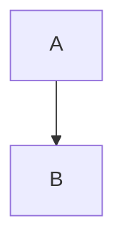

# Slidev syntax quick reference

## File structure

```md
---
theme: seriph            # file-level frontmatter (top of file only)
transition: slide-left
mdc: true
---

# Slide 1 title          ← uses default `cover` only on first slide if layout set

---                       ← slide separator
layout: two-cols          ← per-slide frontmatter AFTER the separator
---

...content
```

## Slide separators & frontmatter

- `---` on its own line separates slides. `---` inside frontmatter block divides file-level from slide-level.
- Per-slide frontmatter keys: `layout`, `layoutClass`, `class`, `image` (for image layouts), `hideInToc: true`, `clicks: N` (force click count), `preload: true|false`, `transition` (override per-slide).

## Layouts (built-in)

`cover` `default` `center` `section` `two-cols` `image` `image-right` `image-left` `quote` `iframe` `fact` `end` `intro` `statement` `thanks`
- `two-cols`: left = top-level content, right = after `::right::`.
- `image-right`/`image-left`/`image`: set `image:` frontmatter.
- Custom layouts = `.vue` file in `layouts/` dir of deck or theme.

## Text & styling

- Scoped style block per slide: `<style> h1 { ... } </style>` — applies only to that slide.
- Global styles: root `style.css` file.
- Utility classes (UnoCSS/Tailwind): `class="text-2xl opacity-60 mt-4"`, grid: `grid="~ cols-2 gap-4"`.
- Absolute positioning: `class="abs-br m-6"` (bottom-right), `abs-tl`, `abs-tr`, `abs-bl`, `abs-bm` etc.

## Reveal / animation

- `<v-click>single element</v-click>`
- `<v-clicks>…list items…</v-clicks>` wraps children, one per click.
- Code step highlighting: ```ts {2|3-5|all}``` then arrows can bind: `<arrow v-click="[2,3]" ... />`
- `<Transform scale="0.9">` shrink content; `<v-drag>` draggable element; `<v-fade>` / `<v-pop>` variants.

## Code blocks

- Language + highlight ranges: ```ts {1|2-3|all}```
- `twoslash` for TS type-checked errors: ```ts twoslash```
- Import snippet: ```ts {include:snippets/foo.ts}``` — snippets live in `snippets/`.

## Speaker notes

- HTML comment at end of slide: `<!-- notes here -->`
- Multiple notes separated by `[click]`: `<!-- step one [click] step two -->`

## Components

- Any `.vue` in deck's `components/` dir auto-registers globally (use `<DeckFooter />`).
- Icons: Iconify via installed icon packages — `<carbon:name />`, `<mdi:name />`, `<logos:name />`, `<ph:name />`. Browsable at https://icones.js.org.
- Built-ins: `<SlideCurrentNo />`, `<SlidesTotal />`, `<Toc />`, `<Tweet id="..." />`.

## Mermaid diagrams

````md

````

## Positioning helpers

- `<div class="abs-br m-6">` fixed corner boxes (badges, links).
- Draggable in dev mode: `<v-drag>` element — writes coordinates into frontmatter.

## Export notes

- `slidev export` → PDF (default), `--format pptx|png|md`
- `--with-clicks` exports every click step as a page; `--with-toc` adds outline.
- SPA build: `slidev build` → `dist/`, hostable on Netlify/Vercel/GitHub Pages.
