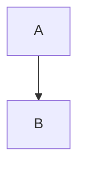

# Slidev syntax quick reference

## The template's own `govuk-*` layouts

Frontmatter keys honoured by these layouts:

| Key | Layouts | Effect |
| --- | --- | --- |
| `title:` | all | text in the black band (or big title on cover/section) |
| `kicker:` | cover, band, section | small eyebrow line / yellow tag (e.g. `'01'`, `'MEETING') |
| `bandColor:` | band layouts | `blue`\|`green`\|`red` band variant |
| `image:` | govuk-image-right, govuk-section | right image / full-bleed dimmed photo |
| `subtitle:`, `meta:`, `author:` | cover, end | cover & closing lines |

```yaml
---
layout: govuk-two-cols
title: 'Method vs baseline'
---

left...

::right::

right...
```

Never write `# Heading` inside a govuk layout — use `title:` in the frontmatter.

## Hierarchy primitives (mandatory)

Every `govuk` / `govuk-two-cols` / `govuk-image-right` slide must set `lead:` — the
takeaway sentence rendered as the big focal line under the band (`.govuk-lead`).
Optional `#aside` slot (on `govuk` only) for greyed secondary material:

```yaml
---
layout: govuk
title: 'MBR decoding scales as O(n²)'
lead: 'Utility replaces hand-tuned metrics — but you pay for every pair.'
---

<ol class="govuk-steps">
  <li>Hypothesis encoding</li>
  <li>Pseudo-reference encoding</li>
  <li>Score matrix</li>
</ol>

<template #aside>
  Baselines: BEURT (O(n²)), SimCSE (O(n)).
</template>
```

Other hierarchy classes: `govuk-takeaway` (green/red/blue accent, ONE per slide),
`govuk-steps` (numbered pipeline), `govuk-caption` (figure provenance).
Budgets: ≤1 anchor, ≤2 emph spans, ≤2 panels, ≤5 bullets — checked by
`scripts/lint-deck.py <deck>/slides.md`.

## Diagram primitives (show, don't tell)

Reach for these BEFORE writing bullets. Full doctrine: design-guidelines.md.

```html
<!-- pipeline: nodes + arrows; blue marks the new component -->
<div class="gov-flow">
  <span class="gov-node"><span class="gov-node-title">input</span><span class="gov-node-sub">x</span></span>
  <span class="gov-arrow">→</span>
  <span class="gov-node gov-node--accent-blue"><span class="gov-node-title">model</span><span class="gov-node-sub">samples</span></span>
  <span class="gov-arrow">→</span>
  <span class="gov-node"><span class="gov-node-title">out</span><span class="gov-node-sub">ŷ₁</span></span>
</div>

<!-- pair scores: matrix with winner cells (`.gov-matrix-win`) and legend -->
<table class="gov-matrix">
  <tbody>
  <tr><th class="gov-matrix-corner"></th><th>y₁</th><th>R(ŷ)</th></tr>
  <tr><th>ŷ₁</th><td>u₁,₁</td><td class="gov-matrix-win">0.17</td></tr>
  </tbody>
</table>
<p class="gov-legend"><span class="lg-red">hypothesis</span><span class="lg-green">selected</span></p>

<!-- "X beats Y": two big numbers, good green / bad red -->
<div class="gov-contrast">
  <div class="gov-bignum gov-bignum--bad"><span class="gov-bignum-n">O(n²)</span><span class="gov-bignum-label">pairs</span></div>
  <div class="gov-bignum gov-bignum--good"><span class="gov-bignum-n">O(n)</span><span class="gov-bignum-label">items</span></div>
</div>

<!-- bottom line: stress box, ▼ therefore, consequence -->
<div class="gov-stress">
  <div class="gov-stress-head"><span>Issue:</span> <span class="gov-stress-value--red">O(n²)</span></div>
  <div class="gov-stress-body">Quadratic Time Complexity</div>
</div>
<div class="gov-therefore gov-therefore--red">▼</div>
<div class="gov-consequence gov-consequence--dark">Extremely Slow</div>

<!-- I/O arrow: value on top, semantic label under (→ ONLY means input/output) -->
<span class="gov-io">
  <span class="gov-io-value">0.7</span>
  <span class="gov-io-arrow">→</span>
  <span class="gov-io-label">utility score</span>
</span>

<!-- labelled arithmetic: values big, semantic labels under each -->
<div class="gov-eq">
  <span class="gov-eq-item"><span class="gov-eq-value gov-eq-value--red">128</span><span class="gov-eq-label"># hypothesis</span></span>
  <span class="gov-eq-op">+</span>
  <span class="gov-eq-item"><span class="gov-eq-value gov-eq-value--green">128</span><span class="gov-eq-label"># reference</span></span>
  <span class="gov-eq-op">=</span>
  <span class="gov-eq-item"><span class="gov-eq-value gov-eq-value--dark">256</span><span class="gov-eq-label"># utility calls</span></span>
</div>
```

Lint warns on slides with >35 words or ≥4 bullets and NO diagram — those must be
redrawn, not reworded.

## File structure

```md
---
theme: seriph            # file-level frontmatter (top of file only)
transition: slide-left
mdc: true
---

# Slide 1 title          ← uses default `cover` only on first slide if layout set

---                       ← slide separator
layout: two-cols          ← per-slide frontmatter AFTER the separator
---

...content
```

## Slide separators & frontmatter

- `---` on its own line separates slides. `---` inside frontmatter block divides file-level from slide-level.
- Per-slide frontmatter keys: `layout`, `layoutClass`, `class`, `image` (for image layouts), `hideInToc: true`, `clicks: N` (force click count), `preload: true|false`, `transition` (override per-slide).

## Layouts (built-in)

`cover` `default` `center` `section` `two-cols` `image` `image-right` `image-left` `quote` `iframe` `fact` `end` `intro` `statement` `thanks`
- `two-cols`: left = top-level content, right = after `::right::`.
- `image-right`/`image-left`/`image`: set `image:` frontmatter.
- Custom layouts = `.vue` file in `layouts/` dir of deck or theme.

## Text & styling

- Scoped style block per slide: `<style> h1 { ... } </style>` — applies only to that slide.
- Global styles: root `style.css` file.
- Utility classes (UnoCSS/Tailwind): `class="text-2xl opacity-60 mt-4"`, grid: `grid="~ cols-2 gap-4"`.
- Absolute positioning: `class="abs-br m-6"` (bottom-right), `abs-tl`, `abs-tr`, `abs-bl`, `abs-bm` etc.

## Reveal / animation

- `<v-click>single element</v-click>`
- `<v-clicks>…list items…</v-clicks>` wraps children, one per click.
- Code step highlighting: ```ts {2|3-5|all}``` then arrows can bind: `<arrow v-click="[2,3]" ... />`
- `<Transform scale="0.9">` shrink content; `<v-drag>` draggable element; `<v-fade>` / `<v-pop>` variants.

## Code blocks

- Language + highlight ranges: ```ts {1|2-3|all}```
- `twoslash` for TS type-checked errors: ```ts twoslash```
- Import snippet: ```ts {include:snippets/foo.ts}``` — snippets live in `snippets/`.

## Speaker notes

- HTML comment at end of slide: `<!-- notes here -->`
- Multiple notes separated by `[click]`: `<!-- step one [click] step two -->`

## Components

- Any `.vue` in deck's `components/` dir auto-registers globally (use `<DeckFooter />`).
- Icons: Iconify via installed icon packages — `<carbon:name />`, `<mdi:name />`, `<logos:name />`, `<ph:name />`. Browsable at https://icones.js.org.
- Built-ins: `<SlideCurrentNo />`, `<SlidesTotal />`, `<Toc />`, `<Tweet id="..." />`.

## Mermaid diagrams

````md

````

## Positioning helpers

- `<div class="abs-br m-6">` fixed corner boxes (badges, links).
- Draggable in dev mode: `<v-drag>` element — writes coordinates into frontmatter.

## Page numbers (global-bottom.vue)

- `global-bottom.vue` renders the bottom-right grey page number via `<SlideCurrentNo />` (hidden on govuk-cover / govuk-section / govuk-end).
- Global layers use `$nav` / `$slidev` directly — do NOT use `useSlideContext()` there; it is outside slide context and silently fails.
- Exports MUST pass `--per-slide` or page numbers all render as "1" (nav state is per page only then). The npm scripts and `export.sh` already include it.
- Disable per deck via frontmatter `deckFooter: false`.

## Export notes

- `slidev export` → PDF (default), `--format pptx|png|md`
- `--with-clicks` exports every click step as a page; `--with-toc` adds outline.
- SPA build: `slidev build` → `dist/`, hostable on Netlify/Vercel/GitHub Pages.
