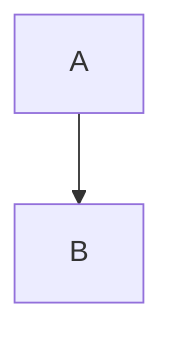

# Slidev syntax quick reference

## The template's own `govuk-*` layouts

Frontmatter keys honoured by these layouts:

| Key | Layouts | Effect |
| --- | --- | --- |
| `title:` | all | text in the navy band (or big title on cover/section/end); `$…$` LaTeX works |
| `subtitle:` | cover, section, end | sage band under the title (cover/end) / grey line under the title (section) |
| `name:`, `jpTitle:` | cover | presenter name (navy) and an optional big secondary-language title |
| `meta:` | cover | grey meta lines — HTML allowed (`'Regular Meeting<br>30 October 2026'`) |
| `author:` | cover, end | affiliation line |
| `kicker:` | band, section, end | band eyebrow; on **govuk-section** the 1-based section number; on **govuk-end** the contact line |
| `sections:` | govuk-section | list of ALL section names → progress rail on the right, current one highlighted (repeat the same list on every divider) |
| `bandColor:` | band layouts | `blue`\|`green`\|`red` band variant |
| `image:` | govuk-image-right, govuk-about | right image / full-bleed photo on the left of the about-me slide |

```yaml
---
layout: govuk-section
kicker: '2'
title: 'Approach'
subtitle: 'Language evolution as a dynamical system'
sections: [Motivation, Approach, Method, Results]
---
```

`govuk-about` is the self-introduction slide: photo left (`image: /about.jpg`
in `public/`), navy panel right with `title` (default `About Me`) and the
slide's bullet list; `<span class="accent-amber">` highlights an item.

```yaml
---
layout: govuk-two-cols
title: 'Method vs baseline'
---

left...

::right::

right...
```

Never write `# Heading` inside a govuk layout — use `title:` in the frontmatter.

## Hierarchy primitives (mandatory)

Every `govuk` / `govuk-two-cols` / `govuk-image-right` slide must set `lead:` — the
takeaway sentence rendered as the big focal line under the band (`.govuk-lead`).
Optional `#aside` slot (on `govuk` only) for greyed secondary material:

```yaml
---
layout: govuk
title: 'MBR decoding scales as O(n²)'
lead: 'Utility replaces hand-tuned metrics — but you pay for every pair.'
---

<ol class="govuk-steps">
  <li>Hypothesis encoding</li>
  <li>Pseudo-reference encoding</li>
  <li>Score matrix</li>
</ol>

<template #aside>
  Baselines: BEURT (O(n²)), SimCSE (O(n)).
</template>
```

Other hierarchy classes: `govuk-takeaway` (green/red/blue accent, ONE per slide),
`govuk-steps` (numbered pipeline), `govuk-caption` (figure provenance).
Budgets: ≤1 anchor, ≤2 emph spans, ≤2 panels, ≤5 bullets — checked by
`scripts/lint-deck.py <deck>/slides.md`.

## Diagram primitives (show, don't tell)

Reach for these BEFORE writing bullets. Full doctrine: design-guidelines.md.

Node types: **components** (models, metrics, pipelines) are drawn as ICONS —
`gov-node--icon` + any carbon/ph icon; **values** (data: `こんにちは`, `ŷ₁`, scores)
are bordered `gov-node` boxes.

```html
<!-- pipeline: wide connectors, value ON TOP / semantic UNDER, model as icon -->
<div class="gov-flow">
  <span class="gov-node"><span class="gov-node-title">こんにちは</span><span class="gov-node-sub">source x</span></span>
  <span class="gov-io">
    <span class="gov-io-value">samples 3</span>
    <span class="gov-io-line"></span>
    <span class="gov-io-label">input sequence</span>
  </span>
  <span class="gov-node gov-node--icon">
    <carbon:machine-learning class="gov-node-icon" />
    <span class="gov-node-sub">Translation Model</span>
  </span>
  <span class="gov-io">
    <span class="gov-io-value">Hello · Hi · Hey</span>
    <span class="gov-io-line"></span>
    <span class="gov-io-label">candidates ŷ</span>
  </span>
</div>

<!-- wide connector between numbered steps (no data) -->
<span class="gov-connector"></span>

<!-- colour variants: gov-io--red / gov-io--green, gov-node--accent-* -->
```

Icon sets bundled offline: `carbon:*` and `ph:*` (browse icones.js.org for names,
e.g. `carbon:machine-learning`, `carbon:model`, `carbon:chat-bot`,
`carbon:translate`, `carbon:chart-network`, `ph:graph`).

Lint warns on slides with >35 words or ≥4 bullets and NO diagram — those must be
redrawn, not reworded.

## File structure

```md
---
theme: seriph            # file-level frontmatter (top of file only)
transition: slide-left
mdc: true
---

# Slide 1 title          ← uses default `cover` only on first slide if layout set

---                       ← slide separator
layout: two-cols          ← per-slide frontmatter AFTER the separator
---

...content
```

## Slide separators & frontmatter

- `---` on its own line separates slides. `---` inside frontmatter block divides file-level from slide-level.
- Per-slide frontmatter keys: `layout`, `layoutClass`, `class`, `image` (for image layouts), `hideInToc: true`, `clicks: N` (force click count), `preload: true|false`, `transition` (override per-slide).

## Layouts (built-in)

`cover` `default` `center` `section` `two-cols` `image` `image-right` `image-left` `quote` `iframe` `fact` `end` `intro` `statement` `thanks`
- `two-cols`: left = top-level content, right = after `::right::`.
- `image-right`/`image-left`/`image`: set `image:` frontmatter.
- Custom layouts = `.vue` file in `layouts/` dir of deck or theme.

## Text & styling

- Scoped style block per slide: `<style> h1 { ... } </style>` — applies only to that slide.
- Global styles: root `style.css` file.
- Utility classes (UnoCSS/Tailwind): `class="text-2xl opacity-60 mt-4"`, grid: `grid="~ cols-2 gap-4"`.
- Absolute positioning: `class="abs-br m-6"` (bottom-right), `abs-tl`, `abs-tr`, `abs-bl`, `abs-bm` etc.

## Reveal / animation

- `<v-click>single element</v-click>`
- `<v-clicks>…list items…</v-clicks>` wraps children, one per click.
- Code step highlighting: ```ts {2|3-5|all}``` then arrows can bind: `<arrow v-click="[2,3]" ... />`
- `<Transform scale="0.9">` shrink content; `<v-drag>` draggable element; `<v-fade>` / `<v-pop>` variants.

## Code blocks

- Language + highlight ranges: ```ts {1|2-3|all}```
- `twoslash` for TS type-checked errors: ```ts twoslash```
- Import snippet: ```ts {include:snippets/foo.ts}``` — snippets live in `snippets/`.

## Speaker notes

- HTML comment at end of slide: `<!-- notes here -->`
- Multiple notes separated by `[click]`: `<!-- step one [click] step two -->`

## Components

- Any `.vue` in deck's `components/` dir auto-registers globally (use `<DeckFooter />`).
- Icons: Iconify via installed icon packages — `<carbon:name />`, `<mdi:name />`, `<logos:name />`, `<ph:name />`. Browsable at https://icones.js.org.
- Built-ins: `<SlideCurrentNo />`, `<SlidesTotal />`, `<Toc />`, `<Tweet id="..." />`.

## Mermaid diagrams

````md

````

## Positioning helpers

- `<div class="abs-br m-6">` fixed corner boxes (badges, links).
- Draggable in dev mode: `<v-drag>` element — writes coordinates into frontmatter.

## Page numbers (global-bottom.vue)

- `global-bottom.vue` renders the bottom-right grey page number as `{{ $nav.currentSlideNo }}` (hidden on govuk-cover / govuk-end; translucent white on the navy govuk-section).
- Do NOT use the `<SlideCurrentNo />` builtin in global layers: it reads `useSlideContext().$page`, which in stacked print/export renders resolves to the app-route nav (root provide, stuck at slide 1) — so every exported page numbers "1". `$nav` inside global layers is the per-slide context nav and is correct in every render mode.
- Global layers use `$nav` / `$slidev` directly — do NOT use `useSlideContext()` there; only `$nav` from the global-layer context is per-slide-safe.
- Export paths: the npm scripts and `export.sh` pass `--per-slide`, and page numbers stay correct even without it. Keep `--per-slide` anyway: other nav-state-dependent content in global layers (clicks state, transitions) still needs it.
- Disable per deck via frontmatter `deckFooter: false`.

## Export notes

- `slidev export` → PDF (default), `--format pptx|png|md`
- `--with-clicks` exports every click step as a page; `--with-toc` adds outline.
- SPA build: `slidev build` → `dist/`, hostable on Netlify/Vercel/GitHub Pages.
